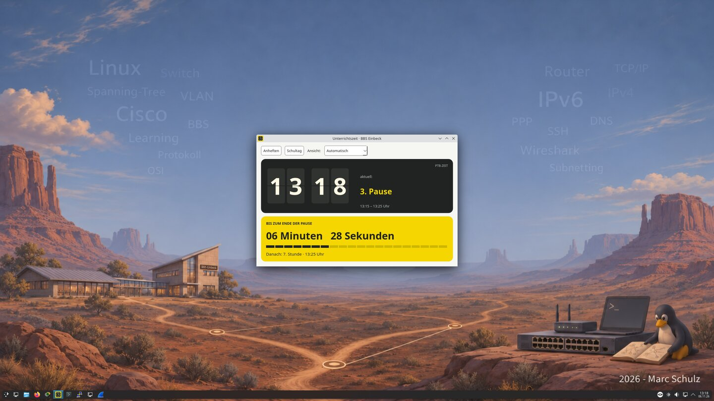
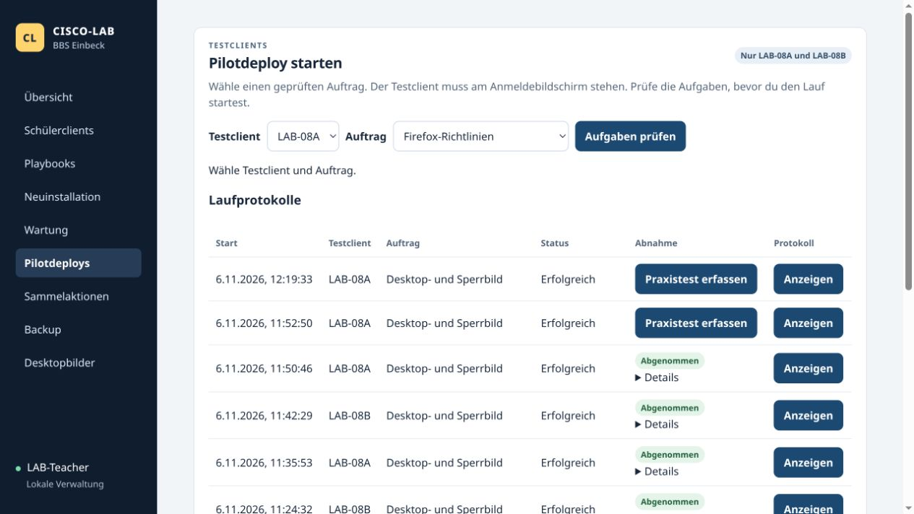

# CISCO Lab Ansible

[Deutsch](README.md) · **English**

Ansible automation and a teacher-operated dashboard for the Linux networking classroom at BBS Einbeck, Germany. The room has 16 student workstations arranged in eight teams, plus a teacher PC. Students practise switching and routing on physical Cisco equipment from Debian 13 and KDE Plasma workstations.

[Project website and screenshots](https://mail896.github.io/cisco-lab-ansible/en.html) · [Operations guide](docs/dashboard.en.md) · [Maintenance guide](docs/wartung-vorschau.en.md)



## A dashboard built for this lab

The lab deliberately uses its own dashboard instead of Semaphore. It follows the classroom workflow. Teachers select reviewed jobs and specific workstations, test on LAB-08A or LAB-08B, then release that same revision to the room.



[Overview](docs/media/dashboard-overview.jpg) · [Pilot deployments](docs/media/dashboard-pilots.jpg) · [Desktop images](docs/media/dashboard-images.jpg)

## How the lab works

Each student workstation has an internal Ethernet interface for the school network and a USB Ethernet interface for exercises. The school interface keeps IServ access and the default route. Students configure static IPv4 and IPv6 addresses and specific routes through the Lab Network dialog. A privileged service checks and applies changes to the assigned USB adapter. Wireshark capture is scoped to that adapter, and the serial launchers coordinate access to the Cisco console cable.

The local dashboard on LAB-Teacher provides pilot deployments, approval before room-wide deployment, image selection, room actions and encrypted backups. Pilot and room deployments keep run logs. The local classroom account is configured independently of IServ and is deliberately provisioned without SSH access.

[Lab topology](docs/labornetz.en.svg) · [Live Lab Network dialog](docs/media/lab-08b-network.jpg)

## Baseline and operations: 7 November 2026

The shared baseline now includes the mandatory Winbind reconnect fix, WOL,
the local classroom account and evening maintenance. The complete LAB-08A run
passed 206 tasks. The GUI provisions two clients concurrently and resumes at
phase boundaries.

The central maintenance controller passed a real LAB-08A WOL, update, reboot
verification and final shutdown trial. Only this pilot is enrolled initially.
Further clients will follow their gradual reinstallation with nonpersistent
tmpfs. Teacher-PC wake and its own maintenance remain open. Profile deletion
has been dropped.

A new encrypted backup was restored in isolation: 356 files, matching SSH key
and a working dashboard. Root-only system configuration still requires the
prepared administrator setup. Retention: 90 days plus the latest confirmed
working backup.

[Installation](docs/media/dashboard-installation.jpg) · [Maintenance results](docs/media/dashboard-maintenance.jpg) · [Backup](docs/media/dashboard-backup.jpg)

## Repository guide

| Path | Purpose |
| --- | --- |
| `dashboard/` | Teacher dashboard, pilot approval, room actions and backup workflow |
| `roles/` and `block*.yml` | KDE, Firefox, serial console and network configuration |
| `network/` | Lab Network dialog, configuration broker and USB capture service |
| `bootstrap-client.yml`, `fresh-client.yml` | SSH admission and guarded baseline for a fresh IServ image |
| `local-cisco.yml` | Local classroom account and its lab desktop defaults |
| `maintenance/` | APT maintenance preview, pilot and systemd timer |
| `inventory.example.ini` | Example inventory to adapt to a local installation |
| `files/README.en.md` | Local assets and artifacts required by selected playbooks |

## Before running anything

Use a lab-only inventory and confirm the SSH fingerprints and school adapter identity. Review `--list-hosts` and `--list-tasks`, start on one pilot, and test sign-in, the school route, the USB lab interface and the apps before approving a classroom deployment. Supply the site-specific values and package files documented in the operations guide.

Repository material covers the LAB clients and LAB-Teacher. The central IServ server is administered separately. Runtime credentials, key material, per-client manifests, encrypted backups and vendor packages are supplied locally.

## Local syntax check

```bash
ansible-playbook -i inventory.example.ini --syntax-check fresh-client.yml
ansible-playbook -i inventory.example.ini --limit LAB-08B --list-tasks fresh-client.yml
```

For published project updates, update both language editions and refresh the affected screenshots when the interface changes.
