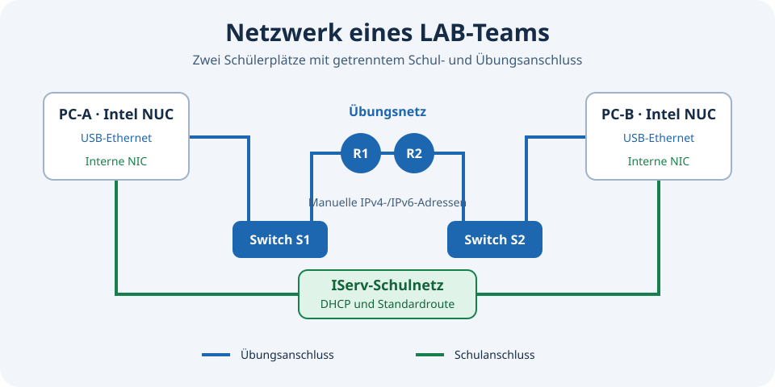

# CISCO-LAB mit Debian und Ansible

Ansible-Baseline für ein Cisco-Netzwerklabor mit Debian- und IServ-Clients.
Sie richtet Arbeitsplätze ein und trennt den Schulanschluss vom Übungsnetz. Die Ansible-Verwaltung läuft
auf einem Rechner der Lehrkraft. Die Clients werden zunächst mit dem
vorgesehenen Schulimage installiert und melden sich an der bestehenden
Schuldomäne an.

## Aufbau



Jeder Arbeitsplatz hat zwei physische Ethernet-Anschlüsse. Der interne
Anschluss dient der Schulverbindung und behält DHCP, DNS und die
Standardroute. Ein USB-Ethernet-Adapter verbindet den Client mit dem
Übungsnetz. Die Laboradressen werden von den Lernenden passend zur
Aufgabe eingetragen. Die Zuordnung nutzt geprüfte Hardwaremerkmale und
die tatsächlichen NetworkManager-Profile des Rechners.

Ansible trennt die Erstaufnahme des Verwaltungszugangs von den
fachlichen Rollen. Vor dem ersten Lauf werden der SSH-Hostschlüssel
und die Adapterzuordnung geprüft. Danach folgen Netzverwaltung,
Konsolenprogramme, Wireshark, KDE, Firefox und Veyon. Der erste Login
mit einem Testkonto prüft die Domänenanmeldung und die Sitzung.

## Verwaltung

Die lokale Oberfläche zeigt Wartungsvorschauen und die Ansible-
Aufgabenfolge für ein gewähltes Ziel. Die spätere Ausführung erhält
fest definierte Aufträge mit Pilotlauf, Freigabe und Laufprotokoll.

Der Wartungspilot unterscheidet zwischen freien und belegten Clients.
Bei einer aktiven Sitzung werden Updates nur zum späteren Installieren
heruntergeladen. Automatische Paketentfernung braucht eine Vorschau,
damit wichtige Komponenten und ein startfähiger Ersatzkernel erhalten bleiben.

## Inhalt einer öffentlichen Fassung

Veröffentlicht werden Architektur, ausgewählte Rollen und Beispiele mit
Platzhalterdaten. Geräteinventar, echte Adressen und Hardwarekennungen,
Zugangsdaten, Schlüssel, Schülerdaten, Diagnoseprotokolle, Sicherungen
und Herstellerpakete bleiben in der lokalen Verwaltungsumgebung.
Die Veröffentlichung entsteht aus einem bereinigten Export.

## Beispiel lokal prüfen

Das Beispielinventar enthält Dokumentationsadressen. Für eine reine
Syntaxprüfung kann es direkt verwendet werden:

```bash
ansible-playbook -i inventory.example.ini --syntax-check fresh-client.yml
ansible-playbook -i inventory.example.ini --limit LAB-08B --list-tasks fresh-client.yml
```

Für den Betrieb sind das eigene Inventar, die verifizierten SSH-Hostschlüssel,
Hardwarezuordnungen und lokal freigegebene Artefakte erforderlich. Die
Beispielwerte für IP- und Zielgrenzen in Bootstrap, Baseline und
Wartungsvorschau müssen dafür an die eigene Installation angepasst werden.
Die Veyon- und Unterrichtszeit-Prüfsummen sind Platzhalter. Den passenden
Desktopstarter, die Bilddateien und den Paketbezug lokal konfigurieren.

- [Lokale Verwaltungsoberfläche](docs/dashboard.md)
- [Wartungsvorschau](docs/wartung-vorschau.md)
- [Beispiel für die Hardwarezuordnung](network/example-host-vars.json)

Die Installationsbeispiele sind für einen freigegebenen Pilotclient
vorgesehen. Die öffentliche Fassung enthält kein gepatchtes Winbind-Modul.
