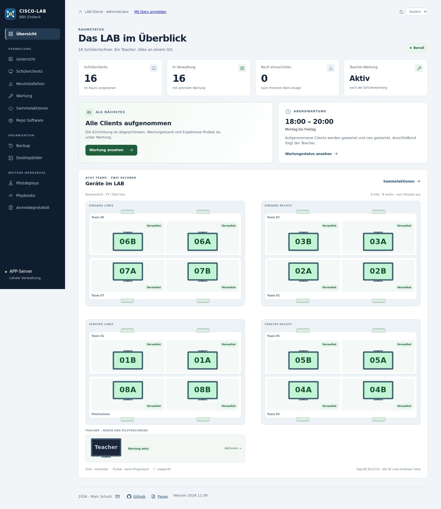
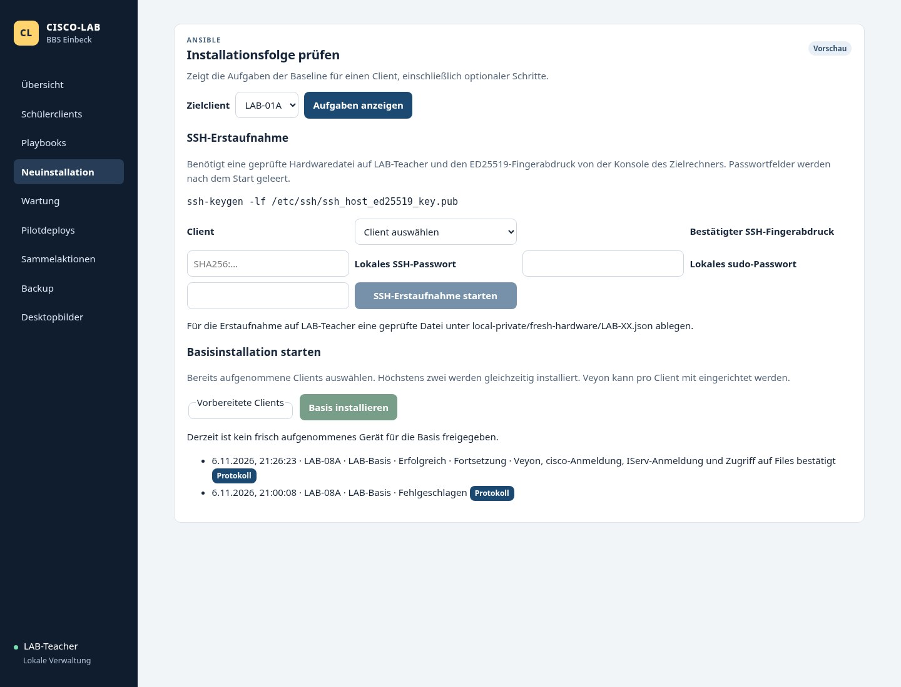
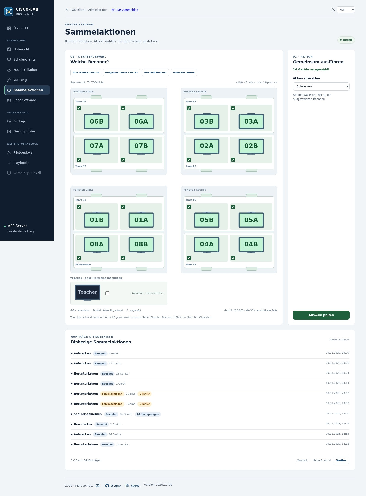
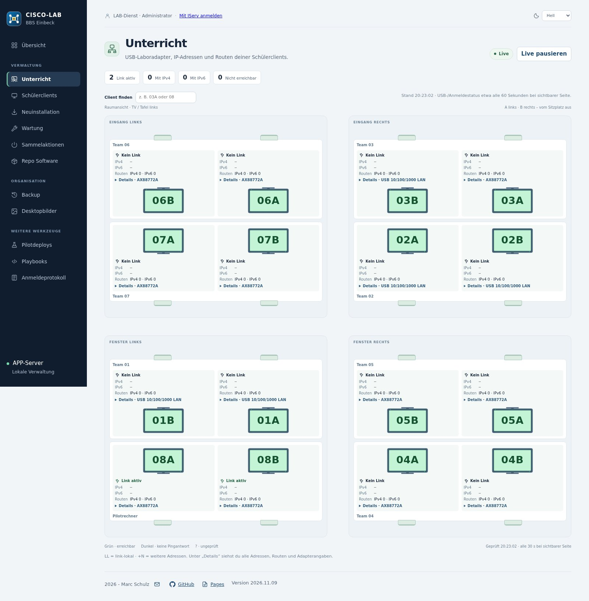
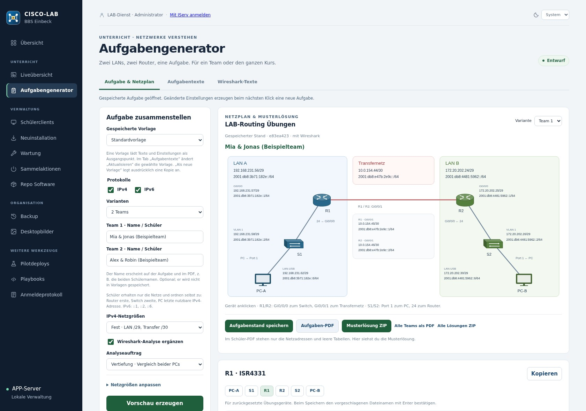
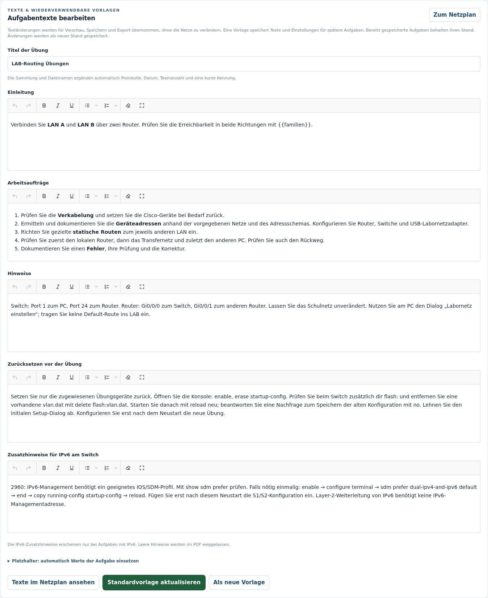
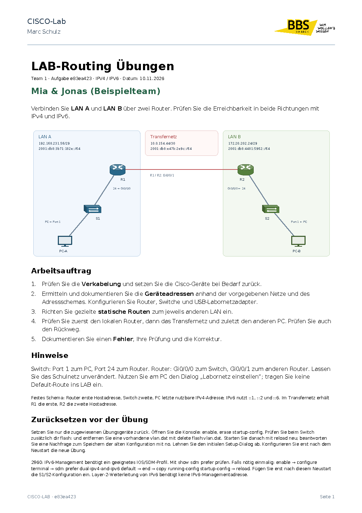
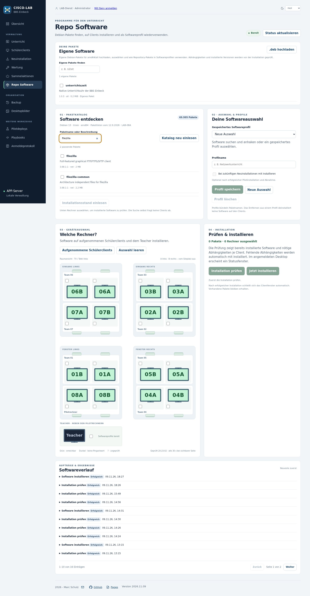
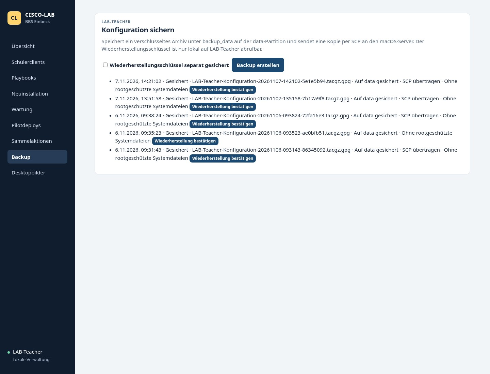

# CISCO-LAB

**Deutsch** · [English](README.en.md)

**Ein Raum. Zwei Netze. Eine Verwaltung.**

Eine zentrale Weboberfläche für ein Debian-/KDE-Netzwerklabor mit IServ: Geräte aufnehmen, Unterricht begleiten, Software verteilen und Wartung steuern.

Im Raum stehen 16 Schüler-PCs in acht Zweierteams sowie ein Teacher-PC. Die interne Netzwerkkarte verbindet jeden Client mit dem Schulnetz; ein USB-Ethernet-Adapter führt ausschließlich ins Übungsnetz mit echten Switches und Routern. Die APP-Verwaltung läuft als eigener Dienst auf einem separaten Server.

[Pages](https://mail896.github.io/cisco-lab-ansible/) · [Bedienung und Workflows](docs/dashboard.md) · [Paketwartung](docs/wartung-vorschau.md)

## Funktionsübersicht

### Raumübersicht

Der echte Raum als gemeinsame Oberfläche. 16 Schülerclients in acht Teams und ein separater Teacher-PC werden in einer gemeinsamen Raumgrafik dargestellt. Vier Tischinseln, Eingang und Fenster sowie die gegenüberliegenden A-/B-Plätze erleichtern die Zuordnung vor Ort. Die Pilotrechner bleiben als eigenes Team erkennbar.

### IServ und Rollen

Ein Login, klar begrenzte Rechte. Die Einstiegsseite führt über „IServ Login“ zur Schulanmeldung. Das fest zugeordnete Administratorkonto verwaltet Geräte, Software, Wartung und Sicherungen. Mitglieder von Kollegium können die freigegebenen Ansichten lesen, sämtliche Sammelaktionen ausführen und den Aufgabengenerator einschließlich eigener Vorlagen verwenden.

### Neuinstallation

Vom frischen IServ-Image zum eingerichteten LAB-PC. Die Betriebssysteminstallation startet der Betreiber über die IServ-Softwareverteilung. Der APP-Workflow setzt ein frisch installiertes Debian-13-Gerät mit KDE und dem vorgesehenen nichtpersistenten tmpfs-Home voraus. Die APP installiert selbst kein Betriebssystem und startet keinen Netzwerkboot.

### Schülerclients

Bestandsdaten und verfügbare Updates. Die Clienttabelle bündelt die gespeicherten Geräte- und Paketstände. Verfügbare Aktualisierungen lassen sich mit ihren Paketnamen ansehen. Nicht gelesene oder fehlgeschlagene Paketstände werden nicht als null Updates ausgegeben.

### Sammelaktionen

Einzelne Plätze, Teams oder den ganzen Raum steuern. Rechner einzeln anhaken oder über eine Teamkachel beide Plätze gemeinsam auswählen. Schnellauswahlen erfassen alle Schülerclients, nur aufgenommene Geräte oder zusätzlich den Teacher. Der Teacher gehört nicht zur Standardauswahl.

### Unterricht

USB-Labornetze live überblicken. Die Unterrichtsansicht verwendet dieselbe Raumgrafik wie Übersicht, Sammelaktionen und Softwareauswahl. Pro Rechner zeigt sie den USB-Link, den erkannten Adaptertyp, IPv4-/IPv6-Adressen und die Anzahl der Routen. Angemeldete grafische Benutzer erscheinen am Sitzplatz, soweit ihr Zustand gelesen werden konnte.

### Aufgabengenerator

Routing-Übungen mit IPv4/IPv6, bis zu acht Teams, editierbaren Vorlagen, Schüler-PDF und Musterlösung ZIP. Bestehende Netze bleiben beim Wechsel der IP-Version erhalten; erst ausdrückliches Speichern übernimmt eine Vorschau in die Sammlung.

[Vollständige Anleitung zum Aufgabengenerator](docs/aufgabengenerator.md)

### Repo Software

Pakete finden, prüfen und gezielt verteilen. Den Debian-Paketkatalog nach Namen oder Kurzbeschreibung durchsuchen und passende Pakete anhaken. Ohne Suchbegriff erscheint keine endlose Gesamtliste. „Katalog neu einlesen“ übernimmt vorhandene Paketlisten eines aufgenommenen Clients; die Suche selbst fragt keine Clients ab und installiert nichts.

### Playbook-Gruppen

Eigene Abläufe aus vorhandenen Bausteinen. Unter Playbooks eine Gruppe benennen, vorhandene Aufgabenbausteine und freigegebene Softwareprofile auswählen und ihre Reihenfolge festlegen. Eine Gruppe ist eine gespeicherte Zusammenstellung; sie verändert nicht die verpflichtende Basis.

### Pilot und Raumverteilung

Änderungen erst prüfen, dann verbreiten. Für einzelne registrierte Aufgaben die Vorschau und den Pilotclient wählen. Der Pilotlauf liefert ein Protokoll; danach wird die praktische Sichtprüfung als Abnahme festgehalten.

### Wartung

Zentrale Planung mit nachvollziehbaren Ergebnissen. APP plant die Abendwartung Montag bis Freitag im Startfenster 18–20 Uhr Europe/Berlin. Auf den Schülerclients gibt es dafür keinen zweiten lokalen Zeitplan. Der Controller berücksichtigt registrierte Geräte und kann ausgeschaltete Geräte per WOL anfordern.

### Desktopbilder

Desktop und Anmeldebild zentral gestalten. Neue Bilder hochladen, in der Bibliothek ansehen und getrennt als KDE-Desktopbild oder SDDM-Anmeldebild auswählen. Die Oberfläche zeigt Vorschaubilder und die aktive Auswahl.

### Sicherung und Wiederherstellung

APP, Mac und ZIP unabhängig wählen. APP-Kopie, externe Mac-Kopie und ZIP-Download können unabhängig ausgewählt werden. Die Browserauswahl bleibt erhalten; bei einem neuen Browser ist zunächst nur APP ausgewählt. Für APP und Mac erscheinen die Ablagepfade und der jeweils letzte Sicherungsstand.

## Technischer Einstieg

Der öffentliche Quellstand verwendet konsistente Beispieladressen und Beispieldomänen. Produktive Infrastrukturwerte und die Zuordnung bleiben im privaten Projekt. Vor jedem öffentlichen Commit und Push werden der vollständige Git-Stand und die Bildfreigaben geprüft; zusätzlich prüft GitHub Actions den veröffentlichten Quellstand.

Die Quellen sind auf Debian 13, KDE Plasma und die konkrete IServ-/LAB-Umgebung abgestimmt. Das ist eine nachvollziehbare Referenzimplementierung, kein universeller Ein-Klick-Installer. Inventar, OIDC-Client, Rollenzuordnung, Hardwaremanifeste und private Pakete müssen zur Zielumgebung passen. Cisco Packet Tracer, private Schlüssel und Schulzugangsdaten sind nicht Bestandteil des öffentlichen Repositorys.

1. [Architektur und Einrichtung](docs/dashboard.md#technik) lesen und `inventory.example.ini` als Vorlage verwenden.
2. Den separaten APP-Dienst mit eigenem Laufzeitkonto, privaten Zuständen und HTTPS/OIDC einrichten; Vorlagen liegen unter `deployment/apps/`.
3. Einen frischen LAB-Client über die GUI aufnehmen, Baseline ausführen und vor Ort praktisch abnehmen.
4. Weitere Clients aufnehmen und anschließend die benötigten Verwaltungsabläufe verwenden.

Neuinstallation und erforderliche IServ-/OIDC-Einstellungen bleiben Betreiberaufgaben.

## Aufbau des Repositorys

| Pfad | Inhalt |
| --- | --- |
| `dashboard/` | Webserver, OIDC, Workflows und gemeinsame GUI-Komponenten |
| `roles/`, `tasks/`, `*.yml` | Ansible-Baseline und registrierte Aufgaben |
| `network/` | Labornetz-Dialog, privilegierter Netzwerkdienst und Mitschnitt |
| `maintenance/` | APP-Controller, Paketplanung und Teacher-Steuerung |
| `deployment/` | Dienstvorlagen, begrenzte Empfänger, Export und Wiederanlauf |
| `tests/` | Backend-, Browser- und Clientintegrationsprüfungen |
| `docs/` | DE/EN-Anleitungen, Pages und echte Screenshots |

## Echte APP-Aufnahmen

Die Screenshots zeigen die laufende deutsche Oberfläche in einer kontrollierten Administrationsansicht. Namen grafisch angemeldeter Personen werden für die Veröffentlichung ausgeblendet. Die englische Dokumentation beschreibt dieselben Funktionen; die Anwendung selbst ist deutschsprachig.

Die zusätzlichen Desktop- und Labornetz-Bilder zeigen reale LAB-Clients; sie dokumentieren die Clientwerkzeuge, nicht eine fernbediente Bildschirmübertragung.

## Version und Kontakt

Dokumentierter APP-Stand: **2026.11.14**. 2026 - Marc Schulz · [E-Mail](mailto:marc.schulz@bbs-einbeck.de)
