# CISCO-LAB · Exercise generator

[Deutsch](aufgabengenerator.md) · [Pages](https://mail896.github.io/cisco-lab-ansible/en.html#exercises)

**2026.11.10** · Prepare, edit and export routing exercises

Unterricht → Aufgabengenerator creates exercises for two LANs, two routers and two switches. The preview, task text, address plan and worked solution belong to the same exercise snapshot. Generating exercises and exporting files does not change any device.

## Workflow

1. **Choose an exercise.** Select IPv4, IPv6 or both, one shared exercise or up to eight team variants, and fixed or random IPv4 prefixes. IPv6 uses /64. Each team can have an optional name. Wireshark offers guided and advanced analysis.

2. **Generate a preview.** Vorschau erzeugen generates new networks without adding entries to the collection. Afterwards, IPv4/IPv6 can be added or hidden: existing addresses remain unchanged and return when re-enabled. Other generation settings apply to the next preview.

3. **Explore the diagram.** Click R1, R2, S1, S2, PC-A or PC-B to open its configuration or the values for the lab-network dialog. IPv4 labels provide subnet-mask tooltips. The web diagram shows the worked solution; the student diagram only contains network addresses.

4. **Edit the text.** Aufgabentexte contains the title, introduction, tasks, notes, reset instructions and IPv6 preparation. The local WYSIWYG editor supports bold, italic, underline and real numbered or bullet lists. PDF paragraphs and continuation lines preserve their indentation.

5. **Add Wireshark.** Wireshark-Texte has the student task, advanced extension and separate worked-solution notes. The exercise checkbox controls whether analysis is exported; the selected level controls the additional text.

6. **Save a snapshot.** Aufgabe speichern explicitly adds the preview to the shared collection. Entries include team names, protocols, time and generated networks. Editing a saved exercise creates a new draft; the original snapshot stays unchanged.

7. **Download a PDF or ZIP.** Exports apply current text and team names without generating new addresses. Aufgaben-PDF and Musterlösung ZIP are available for one team or all variants. Exporting does not automatically save a preview.

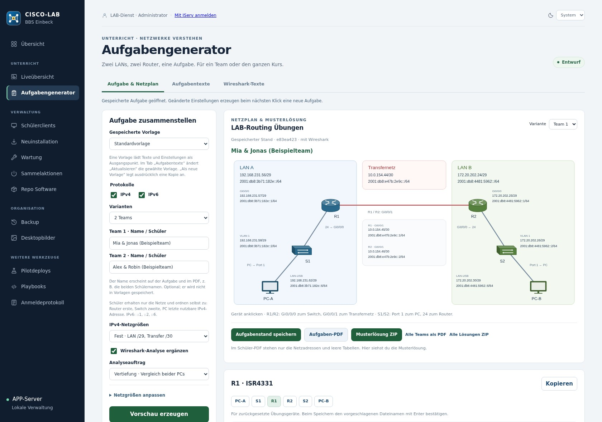

## Features in detail

### Networks and address assignment

Each team has LAN A, a transit network and LAN B. Networks do not overlap excluded school subnets or other team variants. Routers use the first, switches the second and PCs the last usable IPv4 host address. IPv6 uses ::1, ::2 and ::6; R1 and R2 use the first and second transit addresses. Both PCs and routers receive explicit routes to the other LAN. No additional default route into the lab is intended.

### Ports and configurations

ISR4331: Gi0/0/0 to the switch and Gi0/0/1 to the other router. 2960-24TT: Fa0/1 to the PC, Fa0/24 to the router, management on VLAN 1. Configurations target reset training devices. IPv6 management on the 2960 needs an appropriate IOS and SDM profile; editable preparation notes explain any required reboot. Verify CLI compatibility on the actual devices.

### Templates and saved exercises

A template contains text and generation settings, not team names or fixed random networks. Vorlage aktualisieren updates the selected owned template; Als neue Vorlage explicitly creates a named copy. The administrator can change the shared default template. Later template edits do not change existing saved exercises.

### Collection and permissions

All authenticated teachers may generate, read and export exercises. Owners may remove their own templates and exercises; the administrator may manage all entries. Other templates can be copied into owned templates. The collection displays ten entries per page. Bulk deletion requires confirmation of the count; Zurücksetzen only clears the current draft.

### Student worksheet and worked solution

The student PDF contains network addresses and blank address/routing tables; students must determine host assignments themselves. It also includes tasks, editable reset instructions, a diagnosis log and optional Wireshark analysis. Team names appear prominently in green and the date is added automatically. Every page carries the BBS logo, CISCO-Lab, Marc Schulz and its page number. The worked solution contains complete interface addresses, routes and solution notes.

### Storage and limits

Unsaved previews are held in bounded process memory and expire when APP restarts. Explicitly save suitable exercises before class. Text and basic formatting are stored with the snapshot; active HTML and foreign attributes are removed. The generator does not distribute Cisco configurations or replace practical validation of the setup.

## Placeholders

Placeholders are expanded for each team and active protocol during export. Template text retains the placeholders. Example: “Prüfen Sie LAN A: {{lan_a}}.”

| Placeholder | Replacement |
| --- | --- |
| `{{familien}}` | IPv4, IPv6 or IPv4 und IPv6 |
| `{{team}}` | Team variant number |
| `{{lan_a}}` | Active LAN A network address(es) and prefixes |
| `{{lan_b}}` | Active LAN B network address(es) and prefixes |
| `{{transfer}}` | Active transit network address(es) |
| `{{filter}}` | icmp, icmpv6 or icmp || icmpv6 for the selected protocols |

## Worked-solution ZIP contents

```text
Musterloesung.pdf
Team-01/
  Hinweise.txt
  Netzplan.svg
  Adressplan.json
  R1.cfg / R1.txt
  R2.cfg / R2.txt
  S1.cfg / S1.txt
  S2.cfg / S2.txt
  PC-A.txt / PC-B.txt
Quellen.txt
```

Each team variant has its own directory. The CFG and TXT versions of each Cisco configuration have identical contents.

## Screenshots and export examples

Captures show the running German APP with purpose-created example exercises. All team names are fictional and all exercise addresses are generated. The displayed collection was restricted to these examples for capture; no real student data or credentials are included. PDF images show actual exported documents.

### Interactive diagram with complete worked-solution values

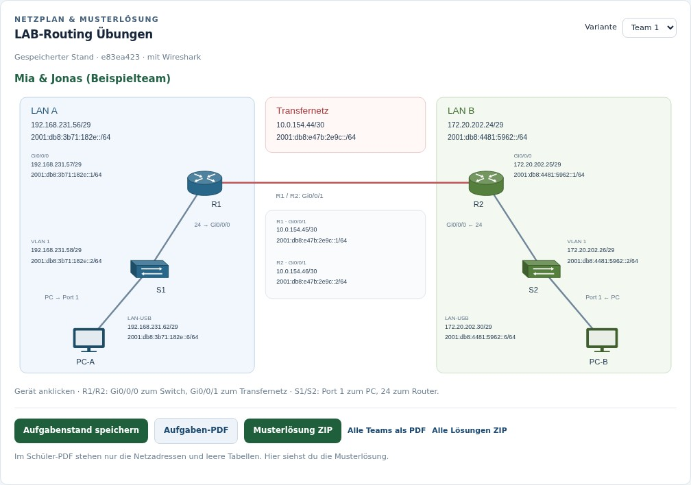

### R1: copyable interface and routing configuration

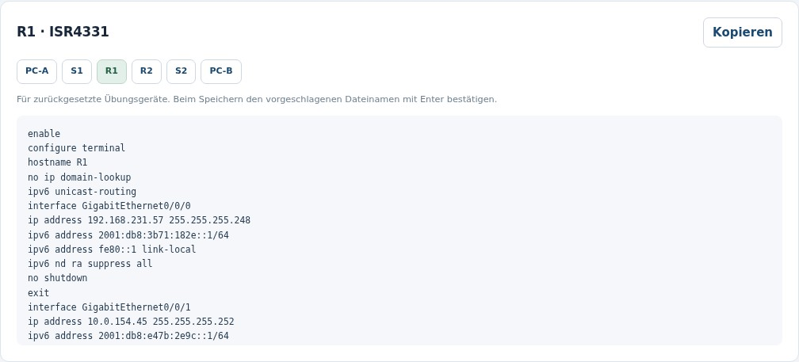

### PC-A: addresses and explicit routes for the lab-network dialog

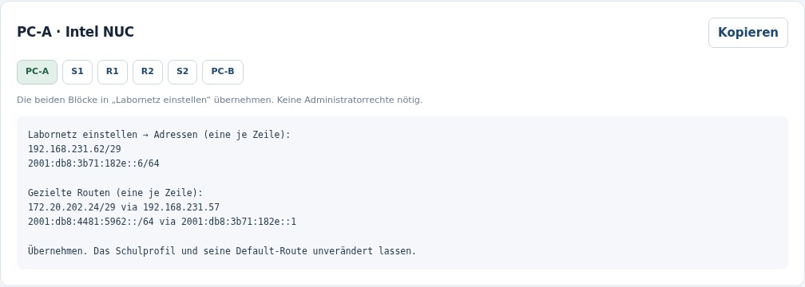

### Formatted task text and reusable templates

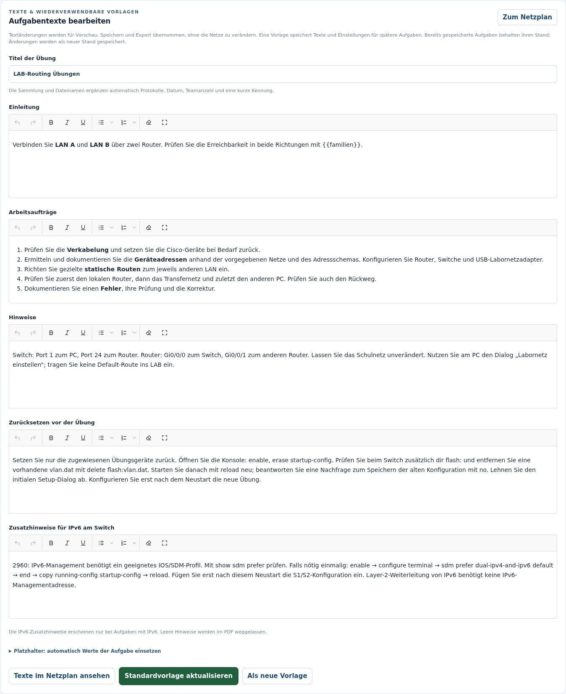

### Editable Wireshark tasks and separate solution notes

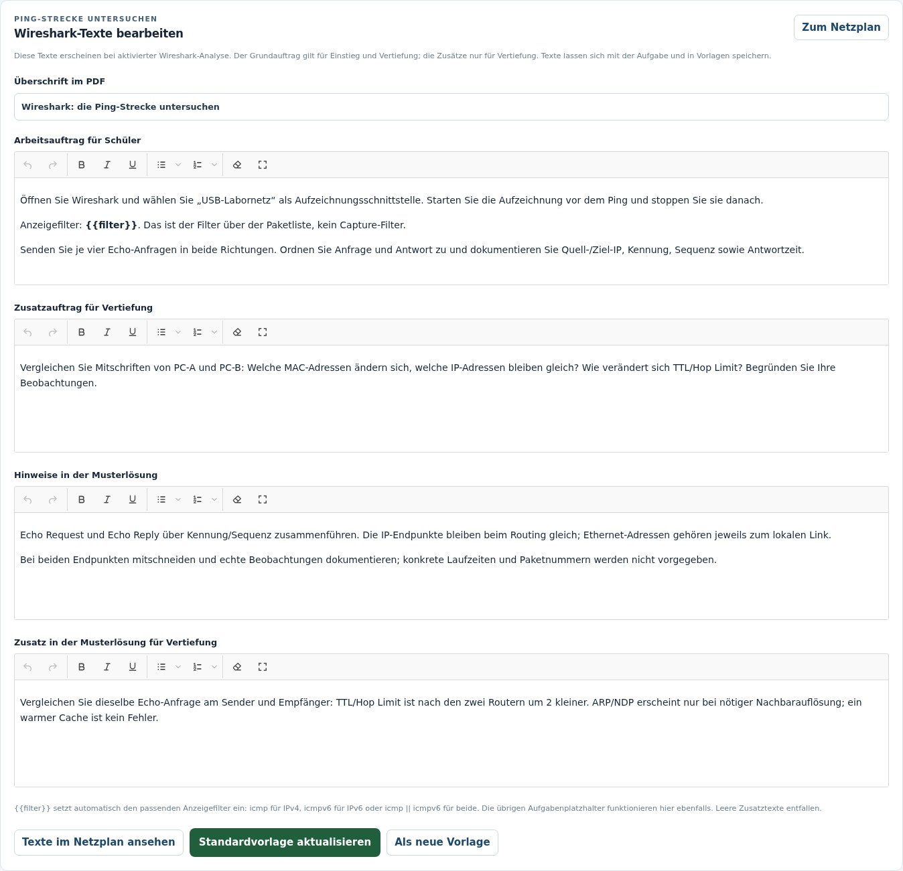

### Saved examples identified by names and networks

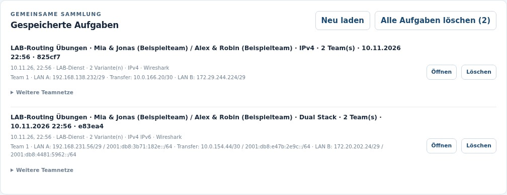

### Actual worksheet PDF: network addresses and student tasks

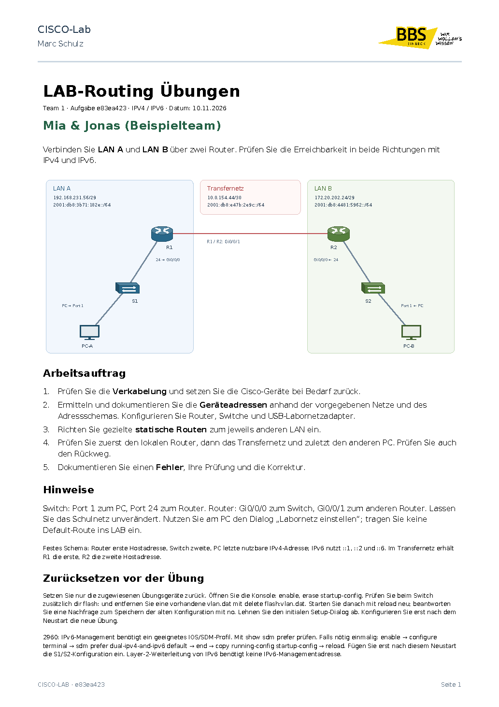

### Blank address/routing tables and diagnosis log

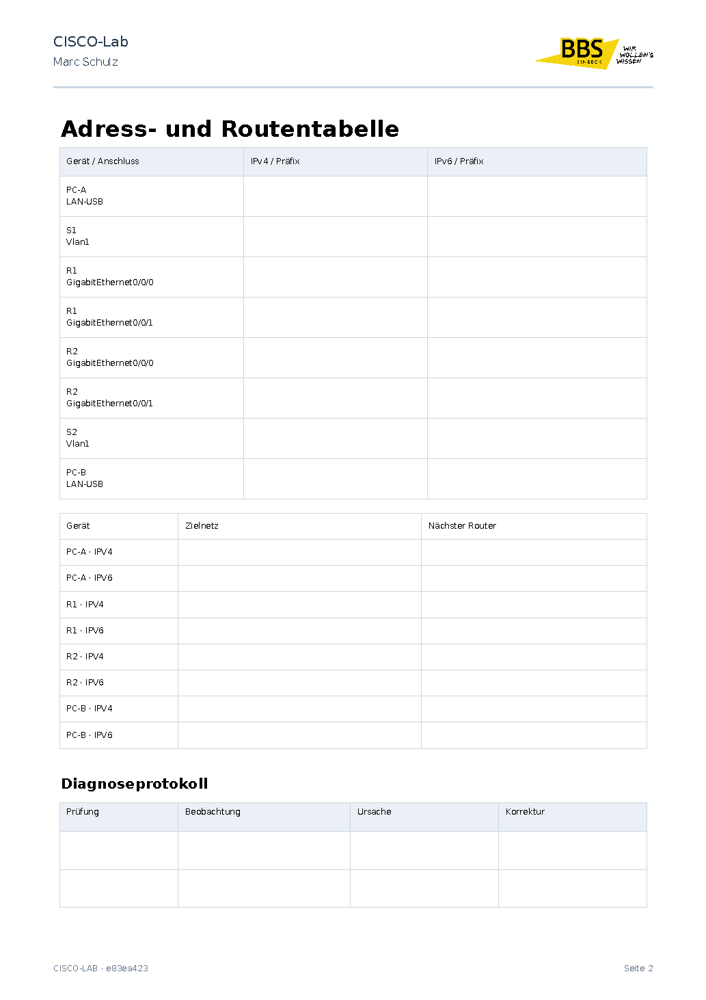

### Wireshark PDF assignment and response table

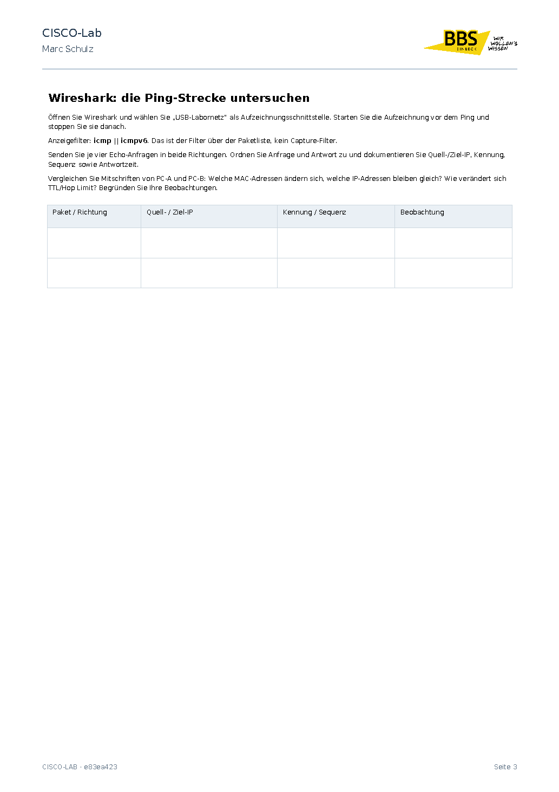

### Worked-solution PDF with interface addresses and routes

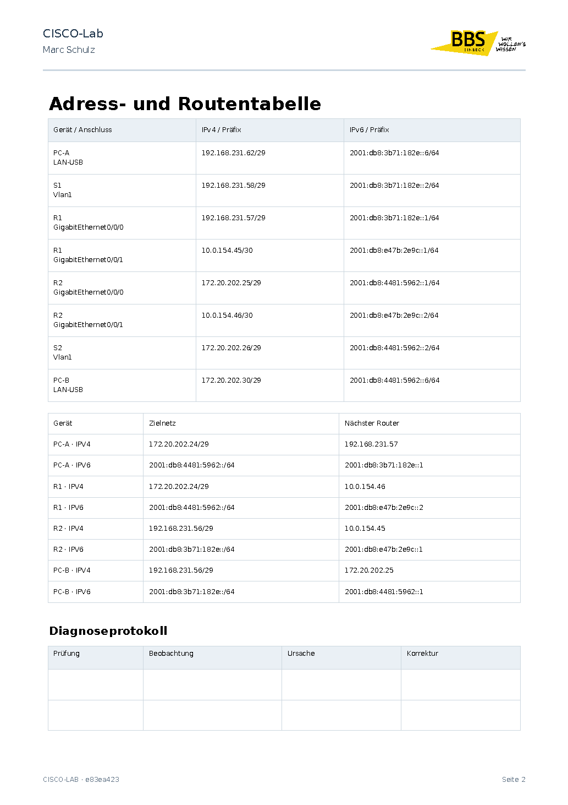

### The same interface in dark mode

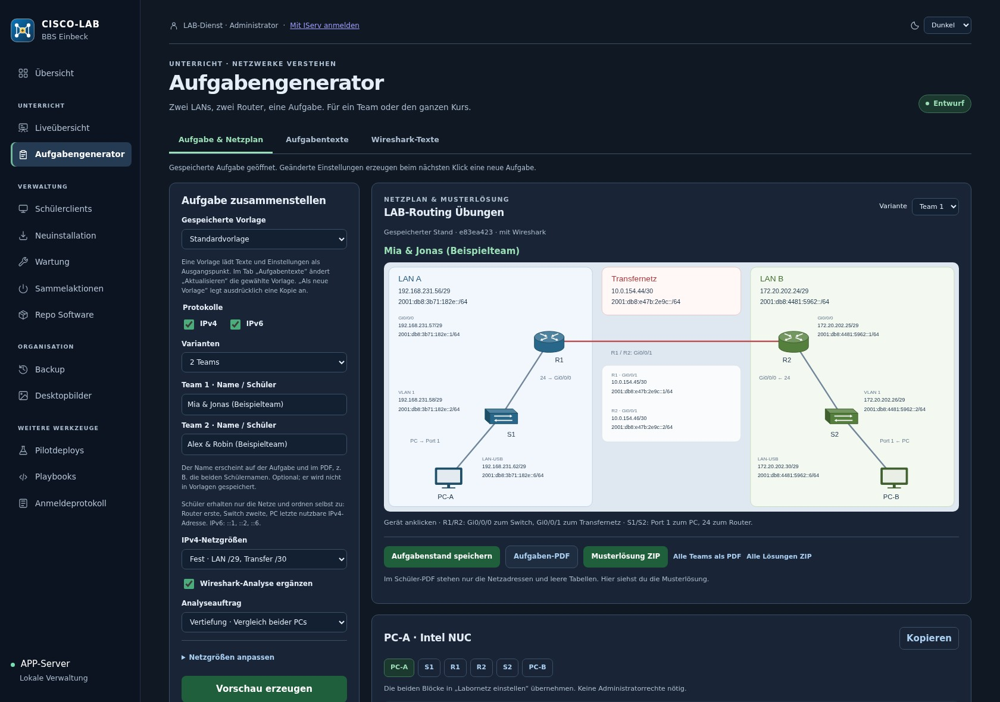

[README](../README.en.md) · [User guide and workflows](dashboard.en.md)
