# CISCO-LAB · Aufgabengenerator

[English](aufgabengenerator.en.md) · [Pages](https://mail896.github.io/cisco-lab-ansible/#exercises)

**2026.11.10** · Routing-Aufgaben vorbereiten, bearbeiten und als PDF ausgeben

Unter Unterricht → Aufgabengenerator entstehen Übungen für zwei LANs, zwei Router und zwei Switche. Vorschau, Aufgabentexte, Adressplan und Musterlösung gehören zu demselben Aufgabenstand. Die Erzeugung und die Exporte verändern keine Geräte.

## Workflow

1. **Aufgabe zusammenstellen.** Wähle IPv4, IPv6 oder beides, eine gemeinsame Aufgabe oder bis zu acht Teamvarianten und feste oder zufällige IPv4-Präfixe. IPv6 nutzt /64. Optional erhält jedes Team einen Namen; für Wireshark stehen Einstieg und Vertiefung bereit.

2. **Vorschau erzeugen.** Wiederholtes Erzeugen würfelt neue Netze, ohne die Sammlung zu füllen. IPv4/IPv6 lassen sich danach hinzufügen oder ausblenden: bestehende Adressen bleiben erhalten und erscheinen beim erneuten Anwählen unverändert. Andere Erzeugungseinstellungen werden bei der nächsten Vorschau angewendet.

3. **Netzplan ansehen.** Ein Klick auf R1, R2, S1, S2, PC-A oder PC-B öffnet die zugehörige Konfiguration beziehungsweise die Eingaben für den Labornetz-Dialog. IPv4-Adressen im Plan haben einen Netzmasken-Tooltip. Der Webplan zeigt die Musterlösung; der Schülerplan enthält nur die Netzadressen.

4. **Texte anpassen.** Im Tab Aufgabentexte lassen sich Titel, Einleitung, Arbeitsaufträge, Hinweise, Rücksetzen und IPv6-Vorbereitung bearbeiten. Der lokale WYSIWYG-Editor bietet Fett, Kursiv, Unterstrichen und echte nummerierte oder unnummerierte Listen. PDF-Absätze und Folgezeilen übernehmen deren Einzüge.

5. **Wireshark ergänzen.** Der eigene Tab Wireshark-Texte enthält den Schülerauftrag, den Vertiefungszusatz und getrennte Hinweise für die Musterlösung. Die Checkbox der Aufgabe bestimmt, ob die Analyse ausgegeben wird; die Stufe bestimmt, ob die Zusatztexte erscheinen.

6. **Aufgabenstand sichern.** Aufgabe speichern legt die Vorschau ausdrücklich in der gemeinsamen Sammlung ab. Der Eintrag enthält Teamnamen, Protokolle, Zeit und die erzeugten Netze. Ändern einer gespeicherten Aufgabe erzeugt einen neuen Entwurf; der ursprüngliche Stand bleibt erhalten.

7. **PDF oder ZIP herunterladen.** Der Export übernimmt die aktuellen Texte und Teamnamen ohne neue Adressen zu würfeln. Aufgaben-PDF und Musterlösung ZIP sind je Team sowie für alle Varianten verfügbar. Der Export speichert eine Vorschau nicht automatisch.

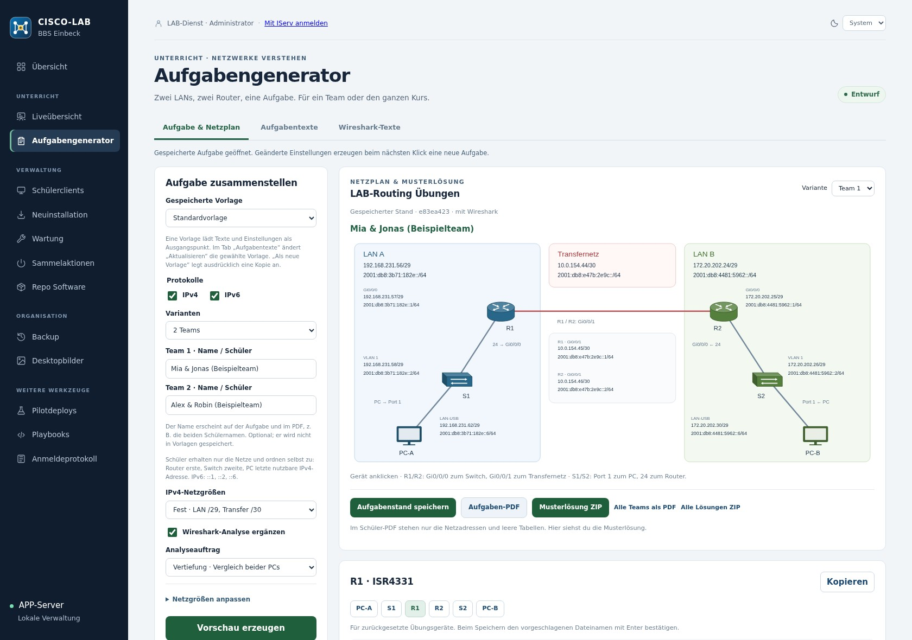

## Funktionen im Detail

### Netze und Adressschema

Jedes Team hat LAN A, ein Transfernetz und LAN B. Die Netze überschneiden sich nicht mit den ausgeschlossenen Schulsubnetzen oder den anderen Teamvarianten. Router erhalten die erste, Switche die zweite und PCs die letzte nutzbare IPv4-Adresse. IPv6 verwendet ::1, ::2 und ::6; im Transfernetz erhält R1 die erste und R2 die zweite Adresse. Beide PCs und Router bekommen gezielte Routen zum anderen LAN. Eine zusätzliche Default-Route ins LAB ist nicht vorgesehen.

### Ports und Konfigurationen

ISR4331: Gi0/0/0 zum Switch, Gi0/0/1 zum anderen Router. 2960-24TT: Fa0/1 zum PC, Fa0/24 zum Router, Management über VLAN 1. Die Konfigurationen sind für zurückgesetzte Übungsgeräte gedacht. Das IPv6-Management des 2960 setzt geeignetes IOS und SDM-Profil voraus; die bearbeitbaren Vorbereitungshinweise erklären den gegebenenfalls nötigen Neustart. Die konkrete CLI-Kompatibilität ist am eingesetzten Gerät zu prüfen.

### Vorlagen und gespeicherte Aufgaben

Eine Vorlage enthält Texte und Erzeugungseinstellungen, keine Teamnamen und keine fest gespeicherten Zufallsnetze. Vorlage aktualisieren ändert die ausgewählte eigene Vorlage; Als neue Vorlage erstellt ausdrücklich eine Kopie mit eigenem Namen. Der Administrator kann die gemeinsame Standardvorlage ändern. Eine spätere Vorlagenänderung verändert keine bereits gespeicherte Aufgabe.

### Sammlung und Rechte

Alle angemeldeten Lehrkräfte dürfen erzeugen, lesen und exportieren. Eigene Vorlagen und Aufgaben können vom Eigentümer entfernt werden; der Administrator kann alle verwalten. Fremde Vorlagen lassen sich als eigene Kopie übernehmen. Die Sammlung zeigt zehn Einträge pro Seite. Alle Aufgaben löschen verlangt eine Bestätigung mit Anzahl; Zurücksetzen entfernt nur den aktuellen Entwurf.

### Schüler-PDF und Musterlösung

Das Schüler-PDF enthält die Netzadressen und leere Adress-/Routentabellen; die Hostadressen müssen selbst ermittelt werden. Hinzu kommen Arbeitsauftrag, bearbeitbare Rücksetzhinweise, Diagnoseprotokoll und optional Wireshark. Teamnamen erscheinen groß und grün, das Datum wird automatisch eingesetzt. Jede Seite trägt BBS-Logo, CISCO-Lab, Marc Schulz und Seitenzahl. Die Musterlösung enthält die vollständigen Geräteadressen, Routen und Lösungshinweise.

### Speicherung und Grenzen

Ungespeicherte Vorschauen liegen nur im begrenzten Arbeitsspeicher und verfallen beim APP-Neustart. Vor dem Unterricht daher passende Stände ausdrücklich speichern. Texte und einfache Formatierungen bleiben im Aufgabenstand erhalten; aktiver HTML-Inhalt und fremde Attribute werden entfernt. Das Werkzeug verteilt keine Cisco-Konfigurationen und ersetzt keine praktische Prüfung des Aufbaus.

## Platzhalter

Die Platzhalter werden je Team und aktiver IP-Version beim Export ersetzt. In der Vorlage bleiben die Kürzel erhalten. Beispiel: „Prüfen Sie LAN A: {{lan_a}}.“

| Kürzel | Ersetzung |
| --- | --- |
| `{{familien}}` | IPv4, IPv6 oder IPv4 und IPv6 |
| `{{team}}` | Nummer der Teamvariante |
| `{{lan_a}}` | Aktive Netzadresse(n) und Präfixe von LAN A |
| `{{lan_b}}` | Aktive Netzadresse(n) und Präfixe von LAN B |
| `{{transfer}}` | Aktive Netzadresse(n) des Transfernetzes |
| `{{filter}}` | icmp, icmpv6 oder icmp || icmpv6 passend zur IP-Auswahl |

## Inhalt der Musterlösung ZIP

```text
Musterloesung.pdf
Team-01/
  Hinweise.txt
  Netzplan.svg
  Adressplan.json
  R1.cfg / R1.txt
  R2.cfg / R2.txt
  S1.cfg / S1.txt
  S2.cfg / S2.txt
  PC-A.txt / PC-B.txt
Quellen.txt
```

Jede Teamvariante erhält einen eigenen Ordner. CFG und TXT derselben Cisco-Konfiguration sind inhaltlich identisch.

## Screenshots und Exportbeispiele

Die Aufnahmen stammen aus der laufenden deutschen APP mit eigens erzeugten Beispielaufgaben. Alle Teamnamen sind fiktiv, alle dargestellten Übungsadressen sind generiert. Die Sammlung war für die Aufnahme auf diese Beispiele begrenzt; echte Schülerdaten und Zugangsdaten sind nicht enthalten. PDF-Abbildungen zeigen tatsächlich exportierte Dokumente.

### Interaktiver Netzplan mit vollständiger Musterlösung

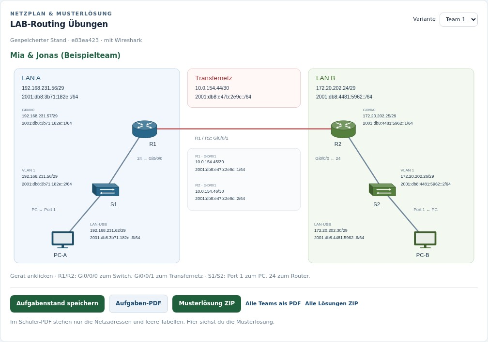

### R1: kopierbare Konfiguration mit Interfaces und Routen

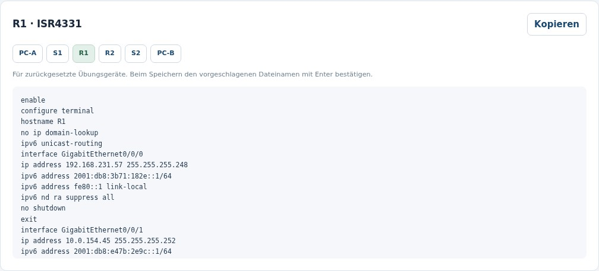

### PC-A: Adressen und gezielte Routen für den Labornetz-Dialog

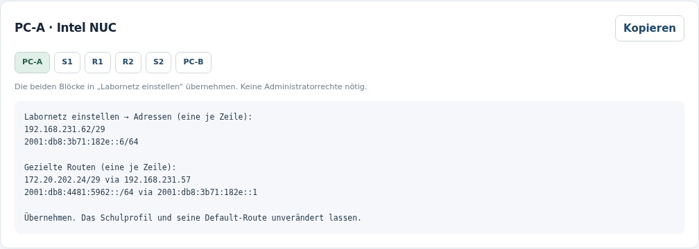

### Formatierbare Aufgabentexte und wiederverwendbare Vorlagen

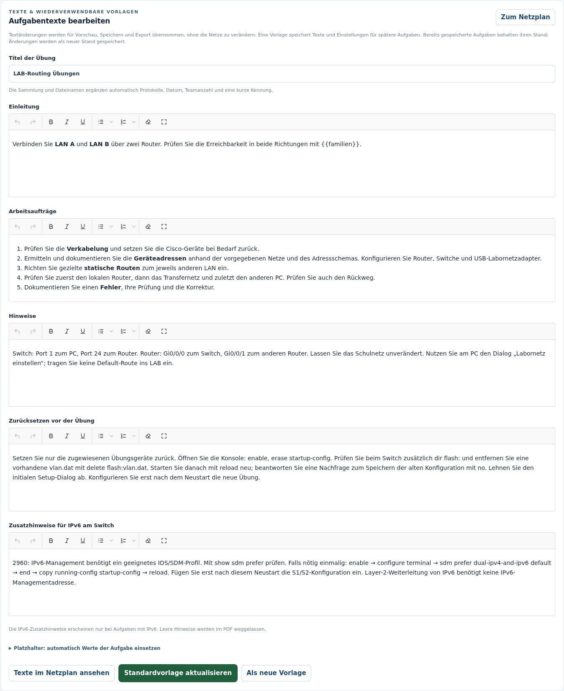

### Eigene Wireshark-Aufträge und getrennte Lösungshinweise

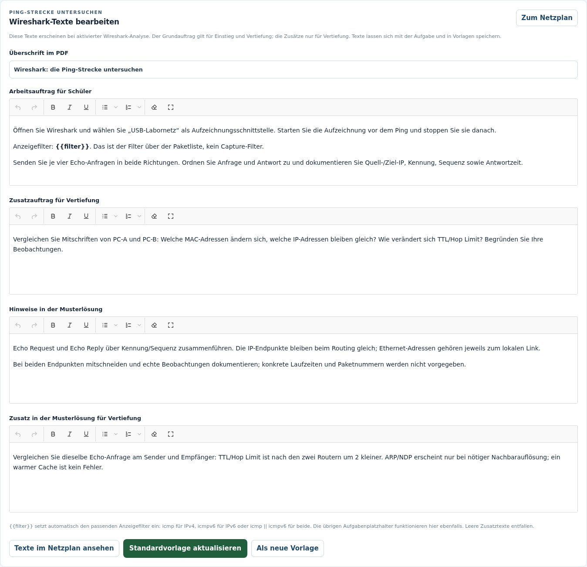

### Gespeicherte Beispiele mit Namen und Netzen

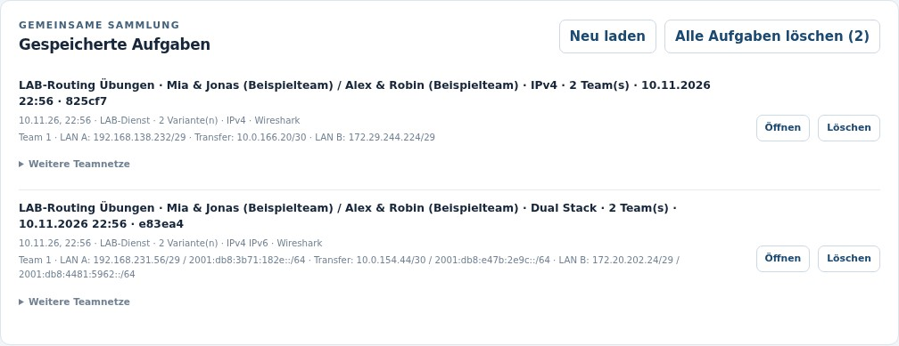

### Echtes Aufgaben-PDF: Netzadressen und Arbeitsauftrag

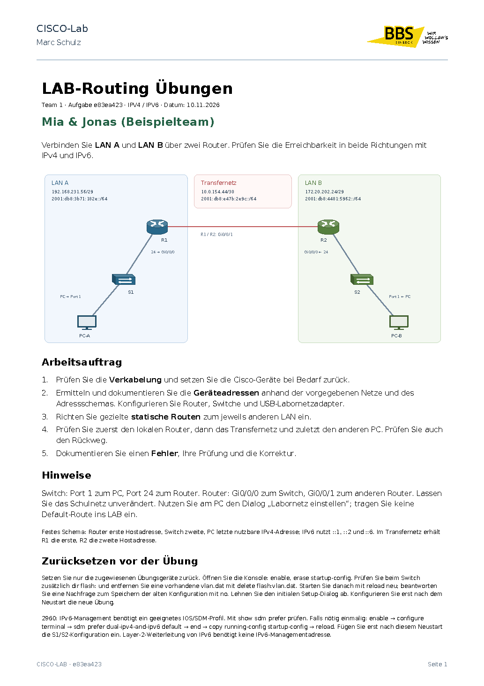

### Leere Adress-/Routentabellen und Diagnoseprotokoll

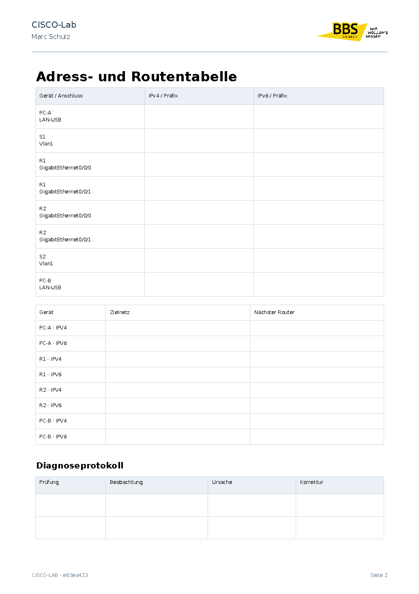

### Wireshark-Auftrag im PDF mit Antworttabelle

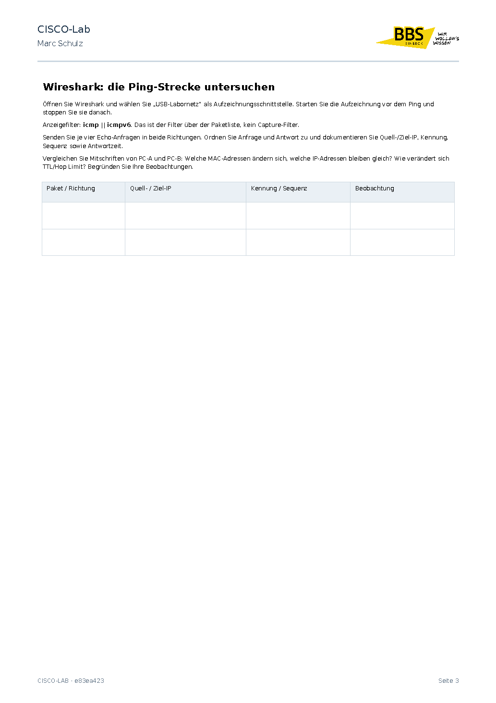

### Musterlösungs-PDF mit Geräteadressen und Routen

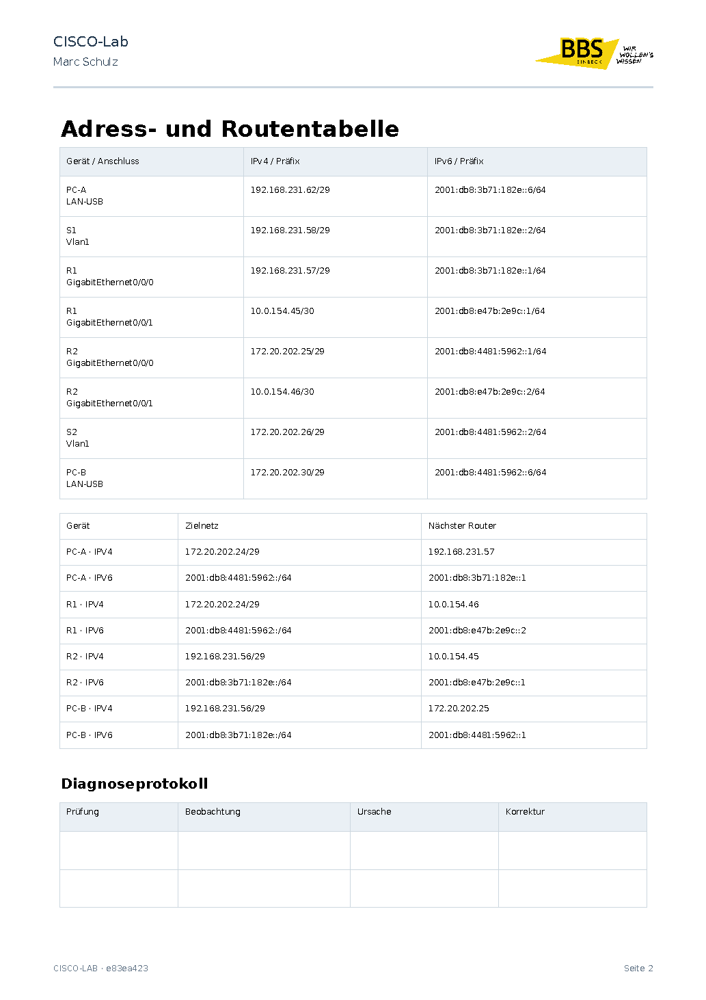

### Dieselbe Oberfläche im dunklen Modus

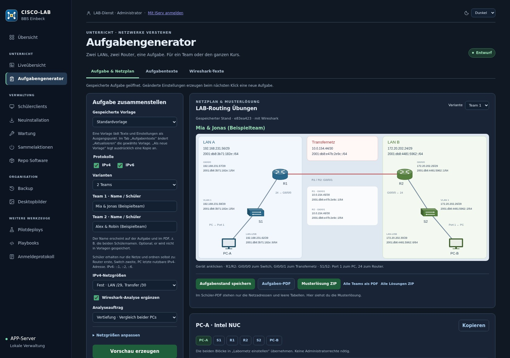

[README](../README.md) · [Bedienung und Workflows](dashboard.md)
