# CISCO-LAB · User guide and workflows

**English** · [Deutsch](dashboard.md)

A central web application for a Debian/KDE networking classroom with IServ: enroll devices, follow lessons, deploy software and manage maintenance.

The classroom contains 16 student PCs in eight two-person teams and a teacher PC. Each client's internal NIC connects to the school network; a USB Ethernet adapter connects to the separate training network with real switches and routers. The APP console runs as its own service on a separate server.

APP version **2026.11.10**. Both guides retain German navigation and button labels so they match the running application.

[Room overview](#overview) · [IServ and roles](#login) · [New installation](#installation) · [Student clients](#clients) · [Bulk actions](#room) · [Teaching view](#classroom) · [Exercise generator](#exercises) · [Repository software](#software) · [Playbook groups](#playbooks) · [Pilot and room rollout](#pilots) · [Maintenance](#maintenance) · [Desktop images](#images) · [Backup and recovery](#backup)

## Room overview

**The actual classroom in one shared view**

The shared room diagram represents 16 student clients in eight teams and a separate teacher PC. Four desk islands, entrance/window labels and opposing A/B seats make devices easy to locate. The pilot devices remain identifiable as their own team.

Monitor symbols contain short device IDs. Green means reachable, dark means no ping response, and a question mark means not checked yet. A dark display does not prove that a device is powered off. Enrollment state and reachability are shown separately.

Summary cards link to relevant pages. The LAB logo reloads the overview. Reachability checks share a 30-second cache and pause while the page is hidden. A banner identifies an active management job.

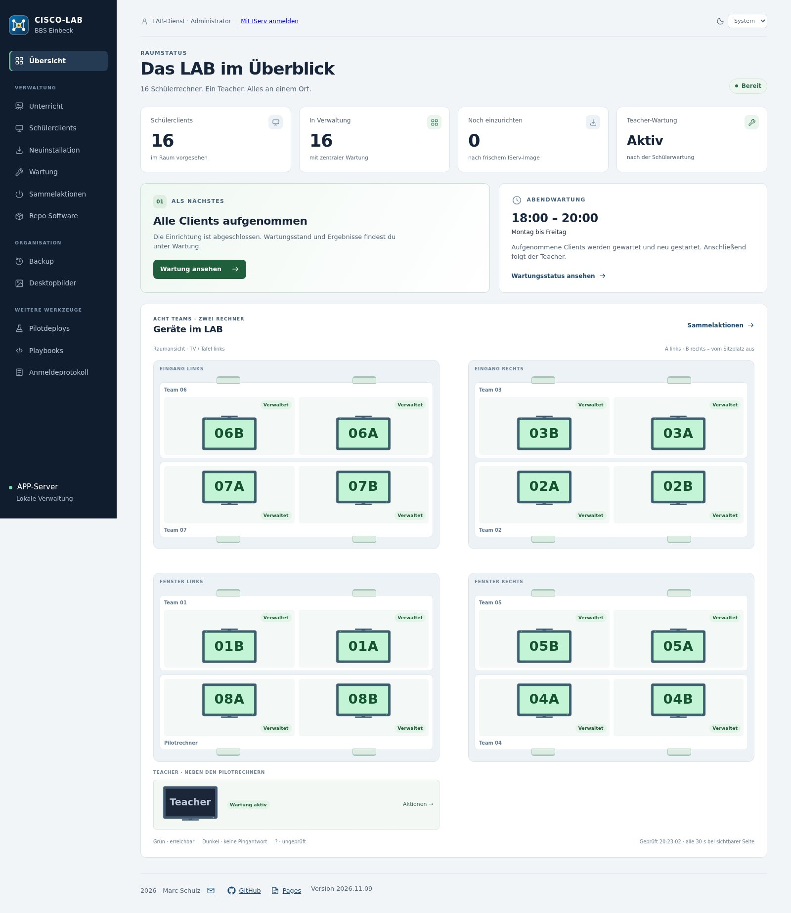

## IServ and roles

**One sign-in with explicit permissions**

The landing page opens school authentication through “IServ Login”. The designated administrator manages devices, software, maintenance and backups. Members of the staff group Kollegium can read permitted views, execute all bulk actions and use the exercise generator with their own templates.

Accounts outside the staff group receive a clear rejection. Successful and denied sign-ins are logged with the identity verified by IServ, when available. Only the administrator can view the sign-in log.

The server enforces permissions. The former local browser login is not offered as a fallback. Light, dark and system appearance can be selected in the header; the browser remembers the preference.

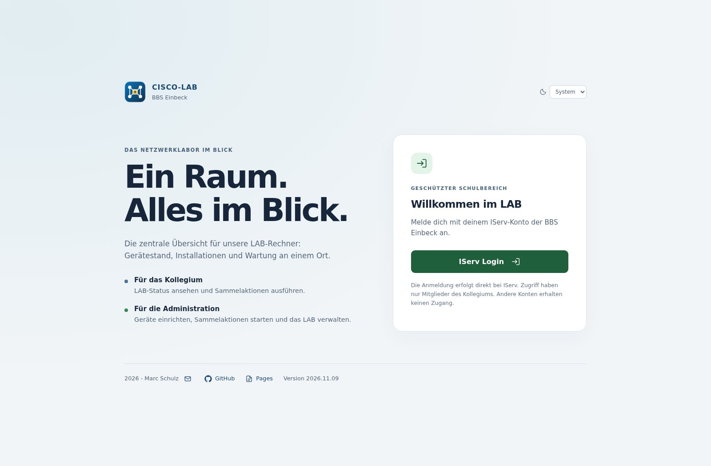

## New installation

**From a fresh IServ image to a configured LAB PC**

The operator starts OS deployment through IServ. The APP workflow expects a freshly installed Debian 13 device with KDE and the intended nonpersistent tmpfs home setup. APP does not install the operating system or initiate network boot.

1. Select freshly installed devices and confirm the rebuild. Use local administrator credentials for the device check and initial SSH enrollment. Multiple devices can be enrolled together using the same credentials.

2. Check the hardware mapping, school NIC and USB lab adapter. The first host key of an explicitly confirmed fresh device is accepted and then pinned. A change to an already known key requires explicit confirmation.

3. Select the mandatory baseline and optionally a custom playbook group. A bounded queue supports concurrent installations; active jobs remain visible independently of history pagination. Device-specific failures and resume options appear beside the affected device.

4. Reboot after completion, sign in with an intended IServ LAB account and check the desktop, lab network, serial console and teaching applications. Record practical acceptance in the GUI. A successful technical run does not replace this visual check.

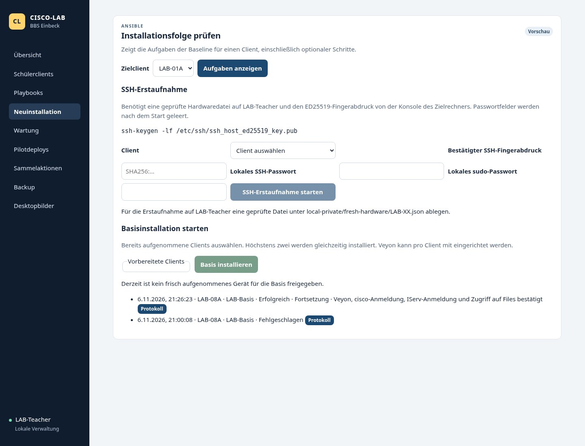

## Student clients

**Inventory and available package updates**

The client table combines saved device and package information. Available updates can be expanded to inspect package names. An unread or failed package inventory is not presented as zero updates.

“Clients prüfen” starts a shared inventory refresh. The page shows when information was checked; navigating between pages does not automatically trigger a full SSH inventory scan. Completed student maintenance marks the shared report stale and triggers one automatic refresh.

The common baseline includes the LAB desktop and SDDM, Firefox policies, the USB lab-network dialog, Wireshark capture, serial console tools, Unterrichtszeit, Packet Tracer, the local shared account and client maintenance. Version-specific Winbind and NUC reboot corrections are included as well.

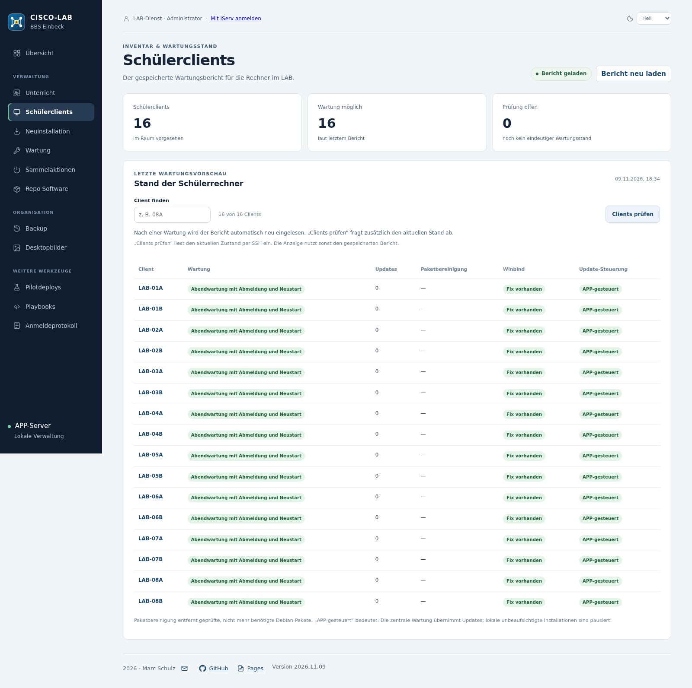

## Bulk actions

**Control individual seats, teams or the whole room**

Tick individual devices or click a team tile to select both seats together. Shortcuts select all student clients, enrolled devices only, or include the teacher. The teacher is excluded from the default selection.

Wake sends WOL packets. Enrolled student clients also support reboot, shutdown, shared-account sign-in/sign-out and student sign-out. Explicitly confirmed manual reboot and shutdown actions end active sessions as well; save work first.

The teacher supports wake and regular shutdown through its restricted receiver. Local or graphical sessions and ongoing package work protect it from shutdown. Student-only actions are not offered for the teacher.

The confirmation displays the chosen action and exact targets. History contains per-device results. “WOL packet sent” confirms transmission, not a completed boot; check reachability in the room diagram.

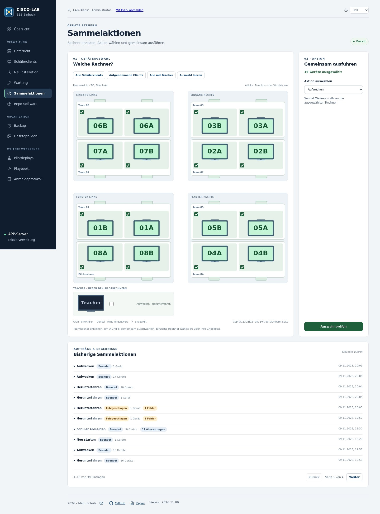

## Teaching view

**See USB lab networks live**

The teaching view uses the same room diagram as the overview, bulk actions and software selection. Each device shows USB link state, detected adapter model, IPv4/IPv6 addresses and route counts. Graphical-session users appear beside their seats when their state could be read.

“Details” expands complete address lists, routes and adapter information including model, driver and USB ID. Link-local IPv6 addresses are distinguished from global addresses. Additional addresses remain visible as a count in the compact view.

USB and session checks run approximately once a minute while the page is visible, using bounded parallel requests. Ping status uses the shared reachability cache. Search and “Live pausieren” help focus a discussion. This view reads state; it does not configure student networks.

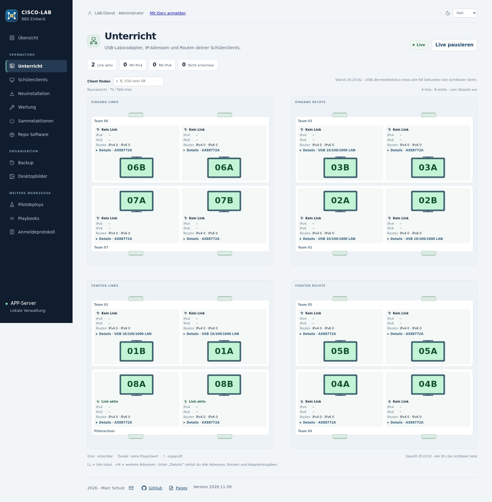

## Exercise generator

Unterricht → Aufgabengenerator creates exercises for two LANs, two routers and two switches. The preview, task text, address plan and worked solution belong to the same exercise snapshot. Generating exercises and exporting files does not change any device.

IPv4/IPv6 routing exercises for up to eight teams, editable templates, student PDFs and worked-solution ZIPs. Existing networks survive protocol selection changes; only explicit saving adds a preview to the collection.

[Complete exercise generator guide](aufgabengenerator.en.md)

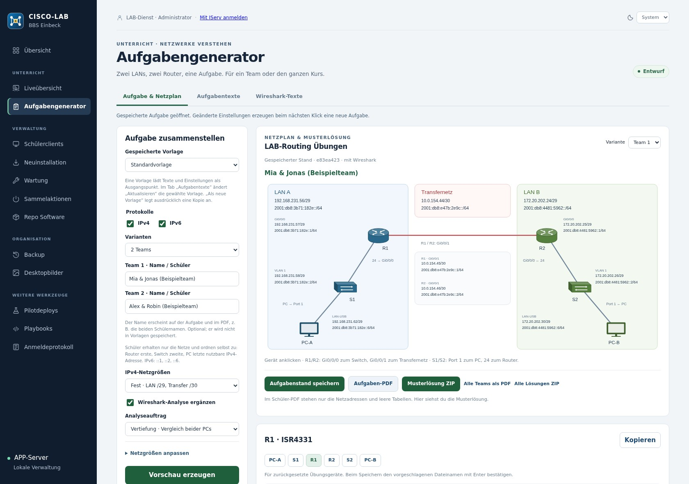

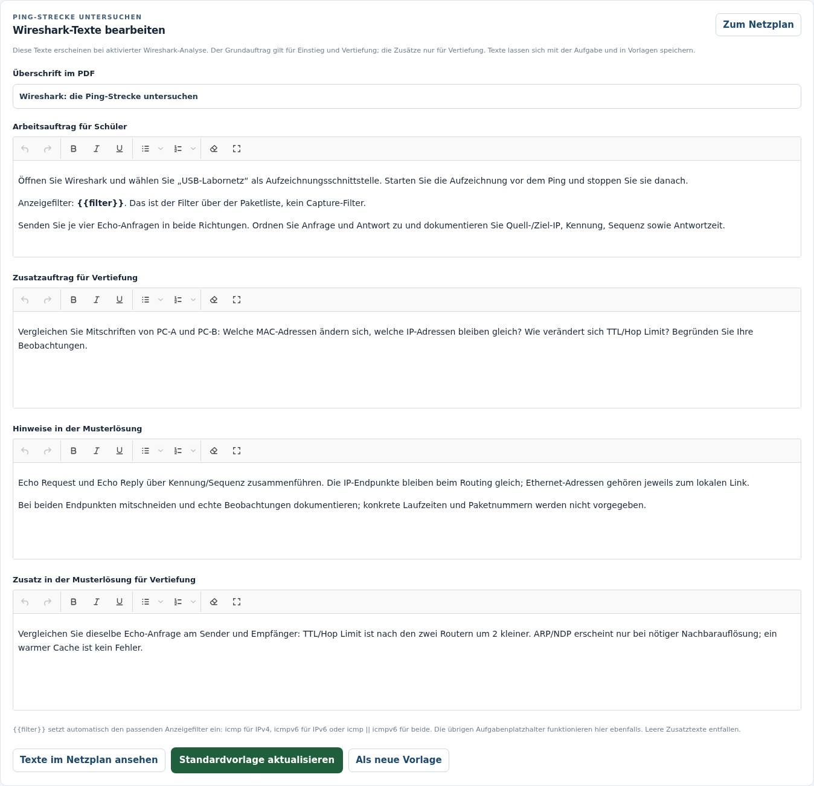

## Repository software

**Find, preview and deploy packages**

Search the Debian package catalogue by name or short description and tick the required packages. An empty search does not list the entire archive. “Katalog neu einlesen” imports existing package lists from an enrolled client; searching itself does not query clients or install software.

Select target devices and optionally read their installed-package inventory. “Installation prüfen” calculates changes per device and shows installed packages and required dependencies. Only a successful current preview enables “Jetzt installieren”. Changing the selection requires a new preview.

APT resolves dependencies. Installation uses the reviewed package plan and retains existing packages. An active graphical desktop displays a client-side progress window that closes automatically on success. At the login screen, results remain available in APP.

Save package names as a software profile, install it on a pilot client and record practical acceptance. An approved profile can optionally be included in future fresh installations or used as a playbook-group module. Removing a package from a profile does not uninstall it.

Upload custom Debian packages and combine them with repository packages in profiles. APP checks package metadata and binds the exact content to the plan. This supports deploying in-house teaching tools to student clients and the prepared teacher PC.

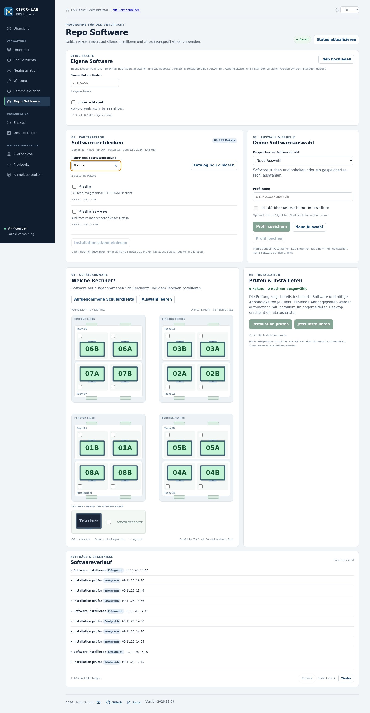

## Playbook groups

**Compose workflows from existing modules**

On the Playbooks page, name a group, select registered task modules and approved software profiles, and set their order. A group is a saved composition; it does not alter the mandatory base configuration.

Groups can run later on selected enrolled student clients or be selected as additions during fresh installation. The GUI exposes related YAML sources, per-device results and logs that can be closed again.

The browser does not accept arbitrary shell commands or uploaded YAML programs. A new custom Ansible module is first implemented and checked in the source project and registered in the task catalogue. It can then be included in groups.

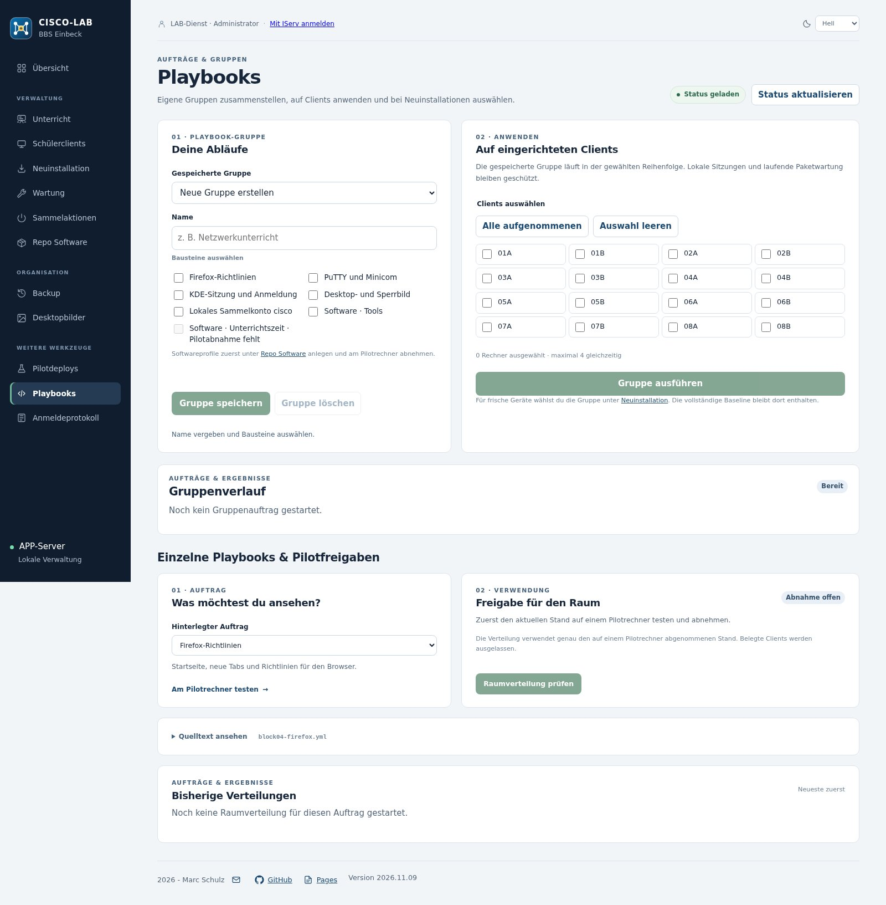

## Pilot and room rollout

**Review changes before distributing them**

For registered individual tasks, select a preview and pilot client. The pilot run provides a log; practical visual checks are then recorded as acceptance.

Room rollout uses the approved version of that task. Unreachable or failed devices remain visible in results and can be retried selectively. Changed tasks require renewed approval.

Fresh-install baselines, software profiles, playbook groups and pilot deployments serve different purposes: the baseline fully configures a fresh device, profiles bundle packages, groups combine registered modules, and pilot deployments validate individual changes before room rollout.

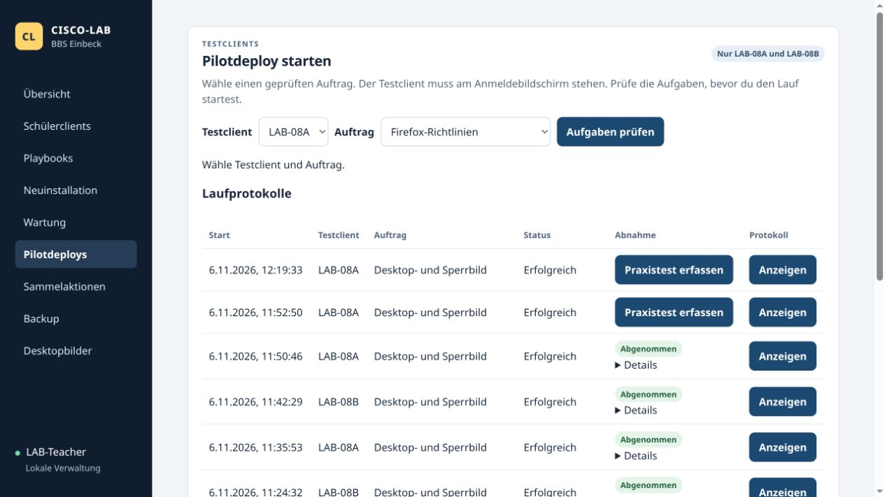

## Maintenance

**Central scheduling with clear outcomes**

APP schedules evening maintenance Monday to Friday within the 18:00–20:00 Europe/Berlin start window. Student clients do not have a competing local schedule. The controller considers enrolled devices and can request powered-off devices through WOL.

Student maintenance signs users out normally, waits for session completion, checks the package plan and system state, installs updates and reboots after success. Leftover RAM homes are handled only after checks. Failures leave the device running for diagnosis.

The administrator can also start maintenance outside the evening window for one, several or all enrolled student clients. Confirmation covers sign-out, updates and reboot. A manual student run does not trigger a subsequent teacher phase.

After a successful automatic student phase, the teacher follows through its restricted receiver. Local/graphical sessions defer teacher maintenance; SSH-only sessions do not block it. A device woken specifically for maintenance is shut down after successful completion; a device that was already on remains on.

History, detailed results and logs distinguish success, failure and deferral. Planned update package names and the shared client report support verification. A completed student result does not imply that the teacher was maintained as well.

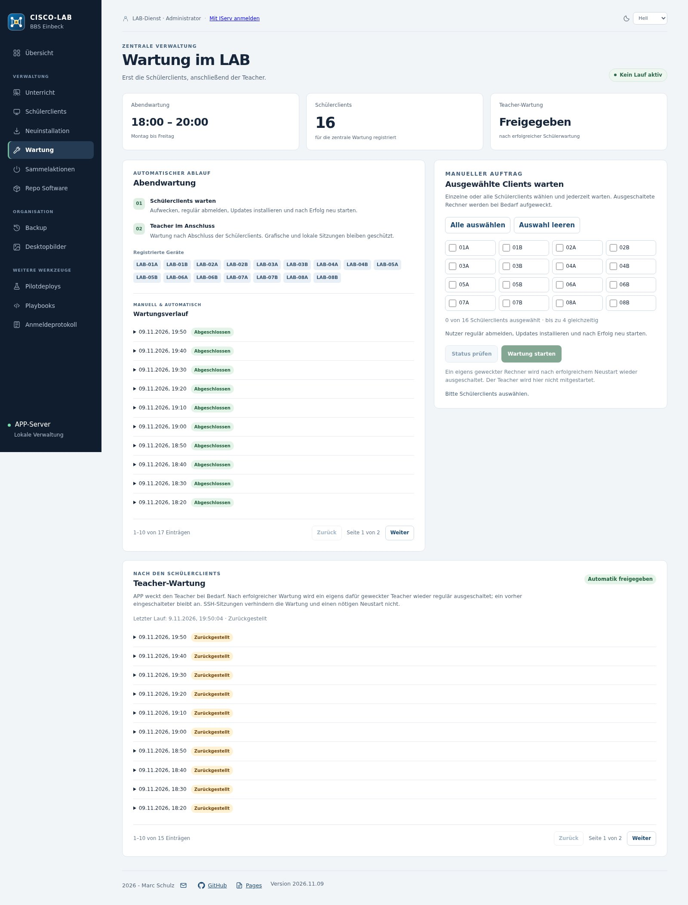

## Desktop images

**Manage desktop and login backgrounds**

Upload images, browse the library and choose KDE desktop and SDDM login backgrounds independently. The page displays thumbnails and the current selection.

Check the image release on a pilot client and distribute the same approved release to the intended devices. Rollout history reports per-device outcomes. Changing the image selection alone is not a completed room rollout.

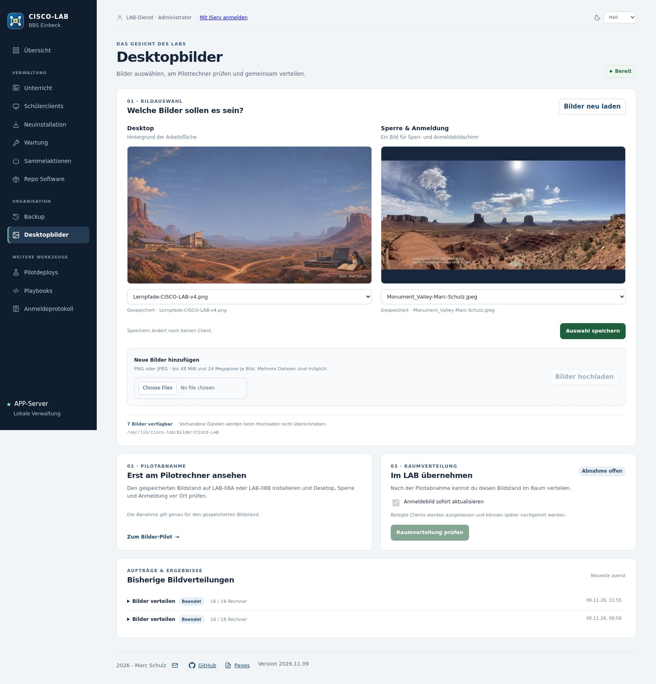

## Backup and recovery

**Choose APP, Mac and ZIP independently**

APP copy, external Mac copy and ZIP download can be selected independently. The browser remembers the selection; a new browser defaults to APP only. APP and Mac each show their storage path and latest backup timestamp.

Archives remain encrypted. ZIP downloads contain the encrypted archive, checksum and recovery instructions. Keep the recovery key separate from the server and archives; it is never published.

“Alte Sicherungen bereinigen” first presents a concrete cleanup preview. The latest APP copy, latest Mac copy and last confirmed restore are protected. Cleanup only covers identified LAB archives.

A replacement server requires the backup, external key, administrator access and working network/DNS/HTTPS configuration. Recovery includes LAB code, private configuration, service keys, image library, state and LAB-specific system files. The virtual environment and collections are rebuilt from pinned dependencies.

This is not a full server image. Other APP projects, shared web-server/firewall configuration and HTTPS keys are not automatically included. The public Git link alone contains no private operational data. Detailed recovery instructions are included in the project and backup package.

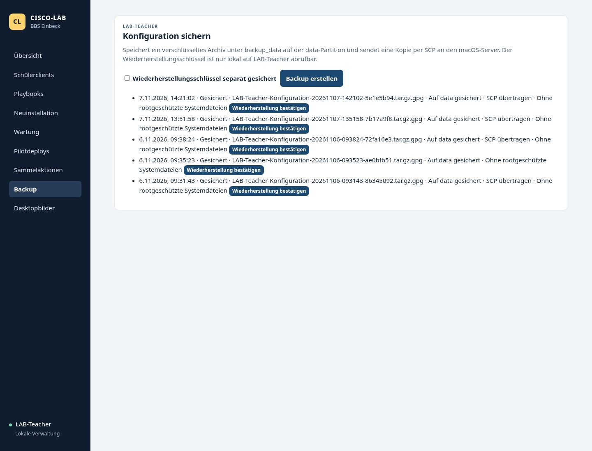

## Architecture and setup

The public export contains documentation addresses and example domains. Adapt them consistently to the target environment before deployment. The operational infrastructure mapping remains private.

The sources target Debian 13, KDE Plasma and the specific IServ/LAB environment. This is an inspectable reference implementation rather than a universal one-click installer. Inventory, OIDC client, role mapping, hardware manifests and private packages must match the deployment. Cisco Packet Tracer, private keys and school credentials are not included in the public repository.

The APP web service listens locally behind HTTPS under `/cisco-lab`. A dedicated service account executes LAB jobs. Root-owned code resides in `/opt/cisco-lab`; private state and service keys reside in `/var/lib/cisco-lab`. Ansible and restricted receivers address only the intended LAB targets.

The OIDC client, callback URL, stable administrator identity and staff group must match the school. Example configuration is not a production credential configuration. Named rejection logging requires IServ to return the verified identity to APP; APP then decides group access.

Shared job locks prevent competing management actions. Visible pages refresh shared caches rather than performing full client inventory scans for every browser. Histories paginate completed entries ten at a time while keeping active jobs visible separately.

Deployment templates: `deployment/apps/`; teacher receiver: `deployment/teacher/`; recovery: [RESTORE.txt](../deployment/apps/RESTORE.txt). Adapt inventory, paths, target checks and private artifacts to a new environment, then validate one pilot client.

## Client workstation

The school NIC retains the default route and IServ access. The lab-network dialog changes only the assigned USB adapter. Students can configure manual IPv4/IPv6 addresses and explicit routes; the school network and default routes remain protected. Wireshark uses the lab adapter, while PuTTY and Minicom use the coordinated serial console path. Unterrichtszeit complements the KDE workspace.

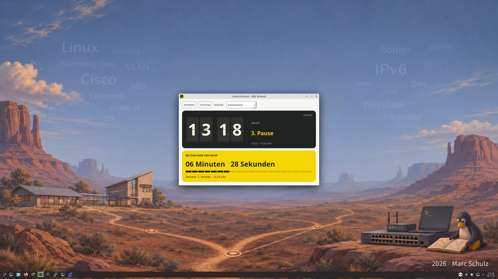

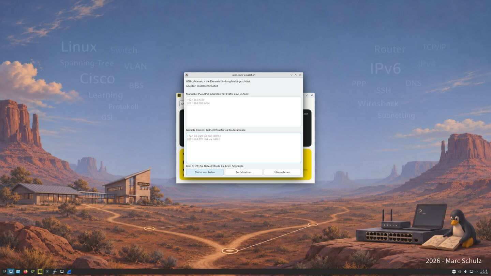

Packet Tracer is proprietary additional software and must be supplied separately. Licence acceptance and Cisco/NetAcad authentication depend on the installed version. Desktop defaults do not replace personal Cisco authentication; no offline guest mode is promised for the version in use.

## Real APP screenshots

Screenshots show the running German application in a controlled administrative view. Names of graphical-session users are hidden for publication. The English documentation describes the same features; the application itself is in German.

Visible timestamps and device states are snapshots, not guarantees of future reachability. Teachers may also generate and export exercises and manage their own templates and collection entries. Other administrative write actions remain restricted.

[README](../README.en.md) · [Pages](https://mail896.github.io/cisco-lab-ansible/en.html)
