# CISCO-LAB · Bedienung und Workflows

**Deutsch** · [English](dashboard.en.md)

Eine zentrale Weboberfläche für ein Debian-/KDE-Netzwerklabor mit IServ: Geräte aufnehmen, Unterricht begleiten, Software verteilen und Wartung steuern.

Im Raum stehen 16 Schüler-PCs in acht Zweierteams sowie ein Teacher-PC. Die interne Netzwerkkarte verbindet jeden Client mit dem Schulnetz; ein USB-Ethernet-Adapter führt ausschließlich ins Übungsnetz mit echten Switches und Routern. Die APP-Verwaltung läuft als eigener Dienst auf einem separaten Server.

APP-Version **2026.11.09**. Die Navigation und Schaltflächen heißen in beiden Anleitungen so wie in der deutschen Anwendung.

[Raumübersicht](#overview) · [IServ und Rollen](#login) · [Neuinstallation](#installation) · [Schülerclients](#clients) · [Sammelaktionen](#room) · [Unterricht](#classroom) · [Repo Software](#software) · [Playbook-Gruppen](#playbooks) · [Pilot und Raumverteilung](#pilots) · [Wartung](#maintenance) · [Desktopbilder](#images) · [Sicherung und Wiederherstellung](#backup)

## Raumübersicht

**Der echte Raum als gemeinsame Oberfläche**

16 Schülerclients in acht Teams und ein separater Teacher-PC werden in einer gemeinsamen Raumgrafik dargestellt. Vier Tischinseln, Eingang und Fenster sowie die gegenüberliegenden A-/B-Plätze erleichtern die Zuordnung vor Ort. Die Pilotrechner bleiben als eigenes Team erkennbar.

Die Monitore tragen die kurzen Gerätekennungen. Grün bedeutet erreichbar, dunkel bedeutet keine Pingantwort; ein Fragezeichen kennzeichnet einen noch ungeprüften Zustand. Ein dunkles Display beweist kein ausgeschaltetes Gerät. Einrichtungsstand und Erreichbarkeit werden getrennt dargestellt.

Kacheln führen direkt zu den passenden Bereichen. Das LAB-Symbol lädt die Übersicht neu. Erreichbarkeitsabfragen teilen sich einen 30-Sekunden-Cache und pausieren bei unsichtbarer Seite. Ein aktiver Verwaltungsauftrag erscheint als Banner.

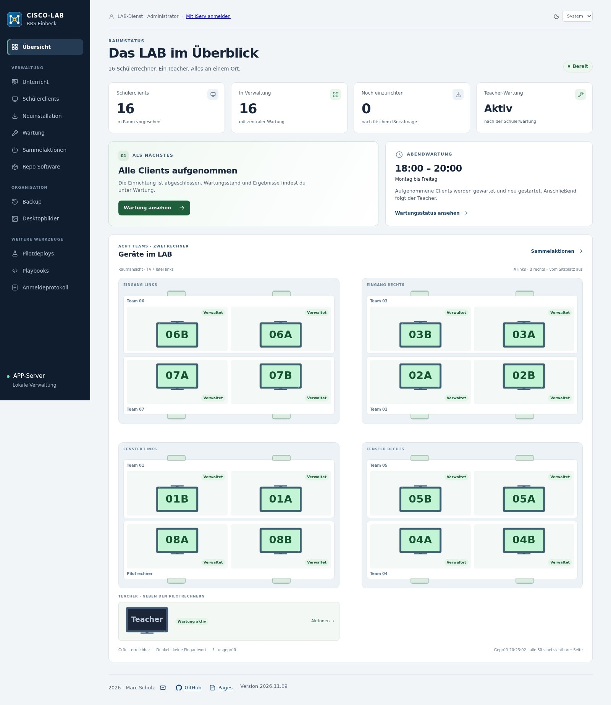

## IServ und Rollen

**Ein Login, klar begrenzte Rechte**

Die Einstiegsseite führt über „IServ Login“ zur Schulanmeldung. Das fest zugeordnete Administratorkonto verwaltet Geräte, Software, Wartung und Sicherungen. Mitglieder von Kollegium können die freigegebenen Ansichten lesen und sämtliche Sammelaktionen ausführen.

Konten außerhalb des Kollegiums erhalten eine verständliche Ablehnung. Erfolgreiche und abgewiesene Anmeldungen werden mit der von IServ bestätigten Identität protokolliert, sofern diese vorliegt. Das Anmeldeprotokoll sieht ausschließlich der Administrator.

Berechtigungen werden serverseitig geprüft. Der frühere lokale Browserlogin steht nicht als Ersatz zur Verfügung. Heller Modus, dunkler Modus und die Systemeinstellung lassen sich oben umschalten; die Auswahl bleibt im Browser erhalten.

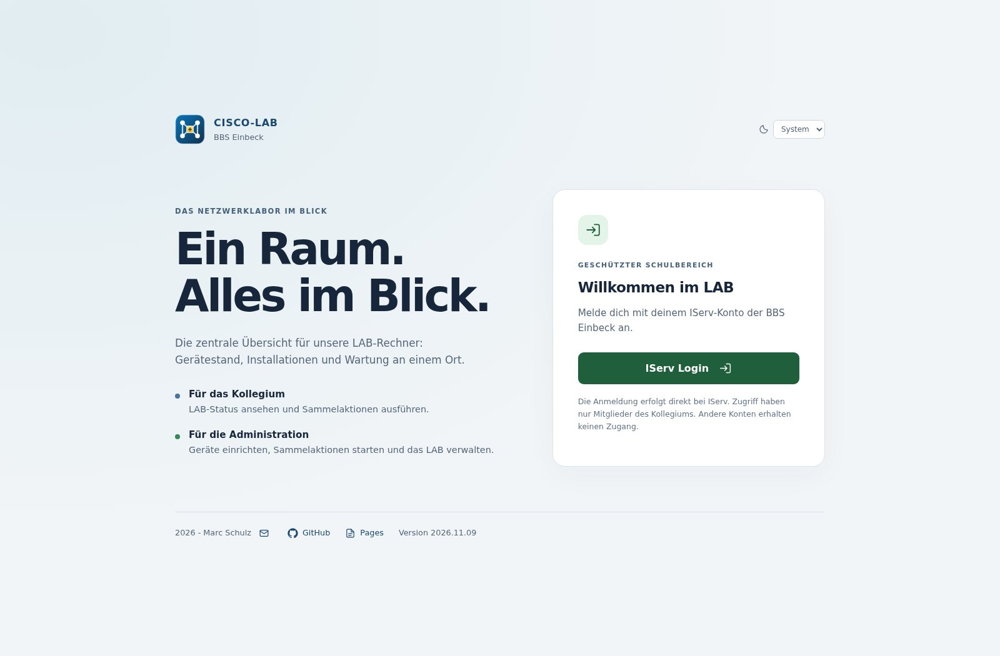

## Neuinstallation

**Vom frischen IServ-Image zum eingerichteten LAB-PC**

Die Betriebssysteminstallation startet der Betreiber über die IServ-Softwareverteilung. Der APP-Workflow setzt ein frisch installiertes Debian-13-Gerät mit KDE und dem vorgesehenen nichtpersistenten tmpfs-Home voraus. Die APP installiert selbst kein Betriebssystem und startet keinen Netzwerkboot.

1. Frisch installierte Geräte auswählen und die Neuinstallation bestätigen. Mit den lokalen Administrator-Zugangsdaten die Geräteprüfung und SSH-Erstaufnahme starten. Mehrere Geräte können gemeinsam mit denselben Zugangsdaten aufgenommen werden.

2. Hardwarezuordnung, Schulnetzkarte und USB-Laboradapter prüfen. Der erste Hostschlüssel eines bestätigten frischen Geräts wird übernommen und danach festgehalten. Ein Wechsel eines bereits bekannten Schlüssels verlangt eine ausdrückliche Bestätigung.

3. Die verbindliche Baseline und bei Bedarf eine eigene Playbook-Gruppe wählen. Aufträge laufen über eine begrenzte Warteschlange mit mehreren parallelen Installationen; aktive Aufträge bleiben unabhängig von der Verlaufsseite sichtbar. Fehler und Fortsetzungsoptionen erscheinen beim betreffenden Gerät.

4. Nach dem Lauf neu starten, mit einem vorgesehenen IServ-LAB-Konto anmelden und Desktop, Labornetz, Konsolenzugang und Unterrichtssoftware prüfen. Die praktische Abnahme wird in der GUI festgehalten. Ein erfolgreicher technischer Lauf ersetzt diese Sichtprüfung nicht.

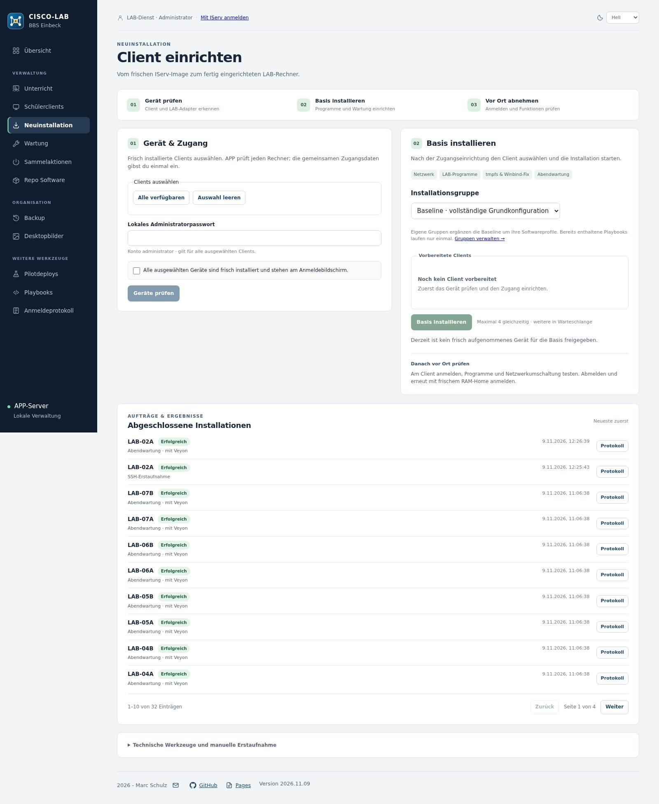

## Schülerclients

**Bestandsdaten und verfügbare Updates**

Die Clienttabelle bündelt die gespeicherten Geräte- und Paketstände. Verfügbare Aktualisierungen lassen sich mit ihren Paketnamen ansehen. Nicht gelesene oder fehlgeschlagene Paketstände werden nicht als null Updates ausgegeben.

„Clients prüfen“ stößt eine gemeinsame Bestandsabfrage an. Die Ansicht zeigt den Prüfzeitpunkt; ein Seitenwechsel führt nicht automatisch zu einer vollständigen neuen SSH-Inventur. Nach einer abgeschlossenen Schülerwartung wird der gemeinsame Bericht als veraltet markiert und einmal automatisch erneuert.

Die gemeinsame Baseline umfasst unter anderem den LAB-Desktop und SDDM, Firefox-Richtlinien, den USB-Labornetz-Dialog, Wireshark-Mitschnitt, serielle Konsolenwerkzeuge, Unterrichtszeit, Packet Tracer, das lokale Sammelkonto und die Clientwartung. Versionsgebundene Winbind- und NUC-Neustartkorrekturen gehören ebenfalls dazu.

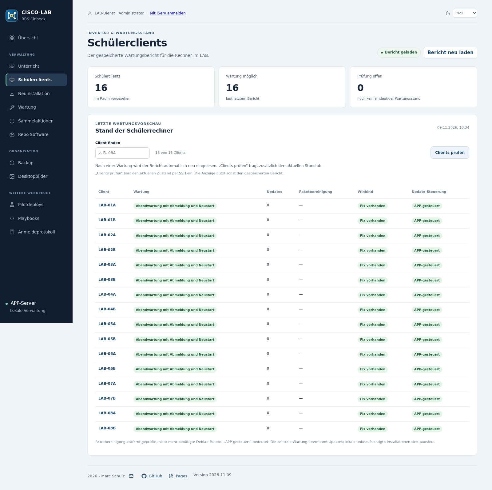

## Sammelaktionen

**Einzelne Plätze, Teams oder den ganzen Raum steuern**

Rechner einzeln anhaken oder über eine Teamkachel beide Plätze gemeinsam auswählen. Schnellauswahlen erfassen alle Schülerclients, nur aufgenommene Geräte oder zusätzlich den Teacher. Der Teacher gehört nicht zur Standardauswahl.

Aufwecken sendet WOL-Pakete. Für aufgenommene Schülerclients stehen außerdem Neustart, Herunterfahren sowie An- und Abmeldung des lokalen Sammelkontos und das Abmelden von Schülern zur Verfügung. Manuell bestätigte Neustarts und Ausschaltaktionen beenden auch aktive Sitzungen; vorher Arbeit speichern.

Der Teacher unterstützt Aufwecken und reguläres Herunterfahren über seinen begrenzten Empfänger. Lokale oder grafische Sitzungen und laufende Paketarbeiten schützen ihn vor dem Ausschalten. Andere Schüleraktionen werden für ihn nicht angeboten.

Vor dem Start zeigt die Bestätigung die gewählte Aktion und die konkreten Ziele. Der Verlauf enthält Ergebnisse je Gerät. „WOL-Paket gesendet“ bestätigt den Versand, nicht den abgeschlossenen Start; dafür die Erreichbarkeit in der Raumgrafik prüfen.

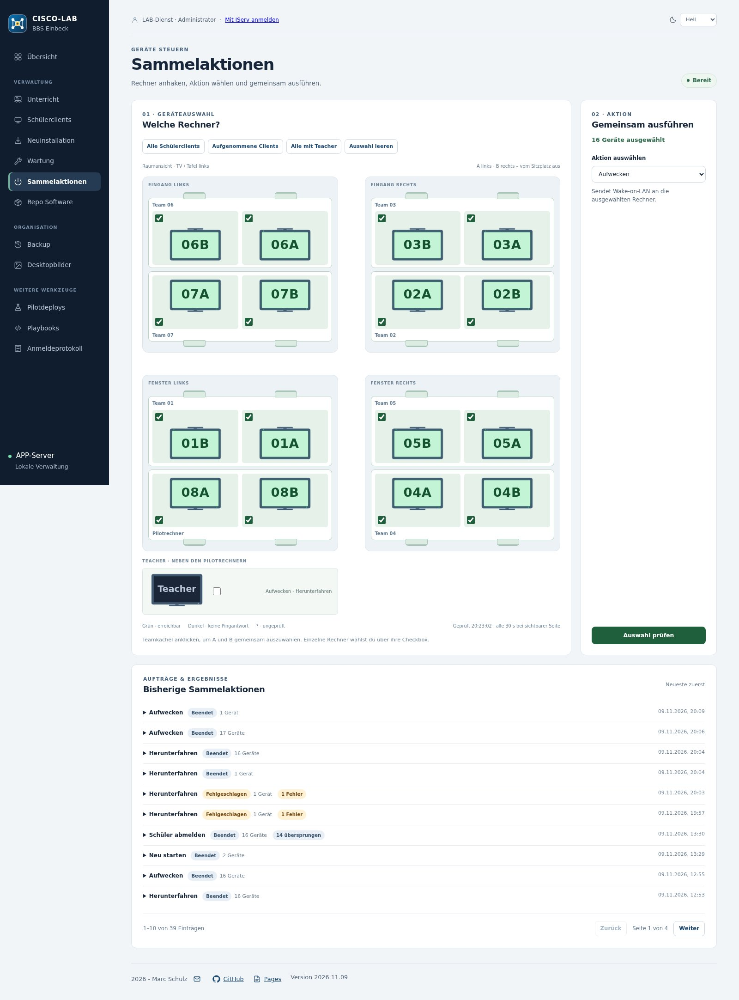

## Unterricht

**USB-Labornetze live überblicken**

Die Unterrichtsansicht verwendet dieselbe Raumgrafik wie Übersicht, Sammelaktionen und Softwareauswahl. Pro Rechner zeigt sie den USB-Link, den erkannten Adaptertyp, IPv4-/IPv6-Adressen und die Anzahl der Routen. Angemeldete grafische Benutzer erscheinen am Sitzplatz, soweit ihr Zustand gelesen werden konnte.

„Details“ öffnet vollständige Adresslisten, Routen und Adapterinformationen einschließlich Modell, Treiber und USB-Kennung. Link-lokale IPv6-Adressen werden von globalen Adressen unterschieden. Zusätzliche Adressen bleiben in der kompakten Ansicht als Anzahl erkennbar.

Die USB-/Anmeldeprüfung läuft bei sichtbarer Seite etwa jede Minute mit begrenzten parallelen Abfragen. Die Pinganzeige nutzt den gemeinsamen Erreichbarkeitscache. Suche und „Live pausieren“ helfen bei der gezielten Besprechung. Diese Ansicht liest Zustände; sie konfiguriert die Schülernetze nicht.

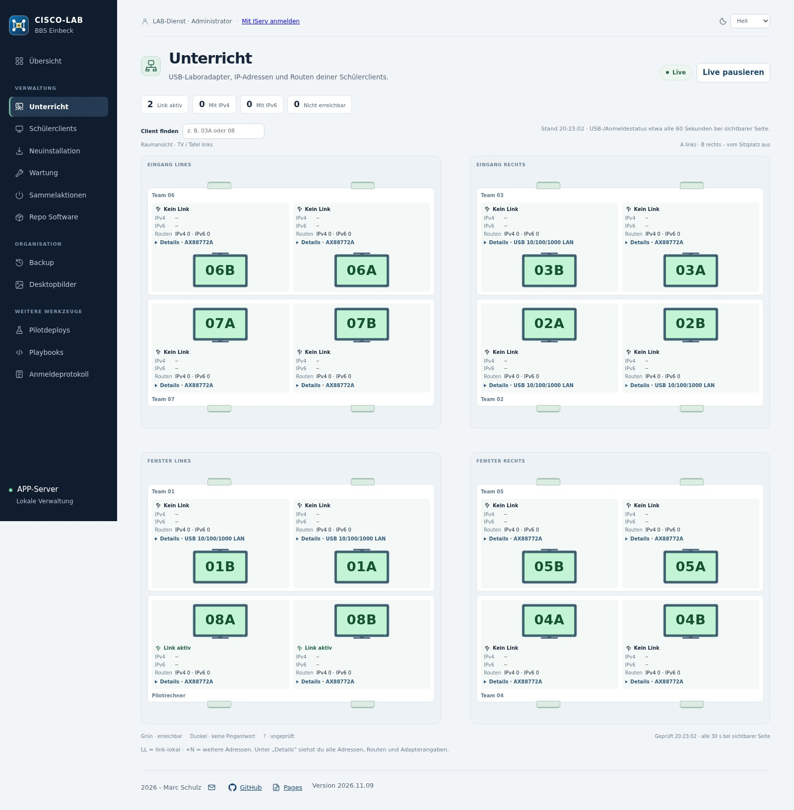

## Repo Software

**Pakete finden, prüfen und gezielt verteilen**

Den Debian-Paketkatalog nach Namen oder Kurzbeschreibung durchsuchen und passende Pakete anhaken. Ohne Suchbegriff erscheint keine endlose Gesamtliste. „Katalog neu einlesen“ übernimmt vorhandene Paketlisten eines aufgenommenen Clients; die Suche selbst fragt keine Clients ab und installiert nichts.

Zielgeräte auswählen und bei Bedarf den Installationsstand einlesen. „Installation prüfen“ berechnet Änderungen je Rechner und zeigt bereits installierte Pakete sowie nötige Abhängigkeiten. Erst die erfolgreiche aktuelle Prüfung schaltet „Jetzt installieren“ frei. Änderungen an der Auswahl benötigen eine neue Prüfung.

APT löst Abhängigkeiten auf. Die Installation übernimmt die geprüfte Paketplanung; bereits vorhandene Pakete bleiben erhalten. Bei angemeldeter grafischer Sitzung zeigt ein Fenster auf dem Client den Installationsfortschritt und schließt nach Erfolg automatisch. Am Anmeldebildschirm bleibt das Ergebnis in APP sichtbar.

Paketnamen als Softwareprofil speichern, auf einem Pilotclient installieren und praktisch abnehmen. Ein freigegebenes Profil kann optional bei künftigen Neuinstallationen mitinstalliert oder als Playbook-Gruppenbaustein verwendet werden. Das Entfernen eines Pakets aus einem Profil deinstalliert es nicht.

Eigene Debian-Pakete lassen sich hochladen und gemeinsam mit Repository-Paketen in Profile aufnehmen. Die APP prüft Paketmetadaten und bindet die konkreten Inhalte an die Planung. So können beispielsweise eigene Unterrichtswerkzeuge auf Schülerclients und den vorbereiteten Teacher verteilt werden.

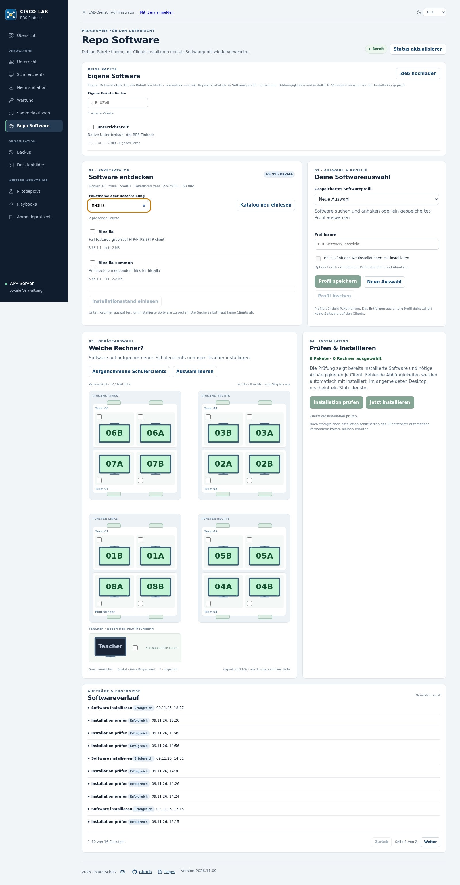

## Playbook-Gruppen

**Eigene Abläufe aus vorhandenen Bausteinen**

Unter Playbooks eine Gruppe benennen, vorhandene Aufgabenbausteine und freigegebene Softwareprofile auswählen und ihre Reihenfolge festlegen. Eine Gruppe ist eine gespeicherte Zusammenstellung; sie verändert nicht die verpflichtende Basis.

Gruppen lassen sich nachträglich auf ausgewählten aufgenommenen Schülerclients ausführen und bei frischen Installationen als Ergänzung wählen. Die GUI zeigt zugehörige YML-Quellen sowie Ergebnisse und schließbare Protokolle.

Die Browseroberfläche erlaubt keine beliebigen Shellbefehle oder frei hochgeladenen YML-Dateien. Ein neuer eigener Ansible-Baustein wird zunächst im Quellprojekt implementiert, geprüft und im registrierten Aufgabenkatalog eingebunden. Danach kann er in Gruppen verwendet werden.

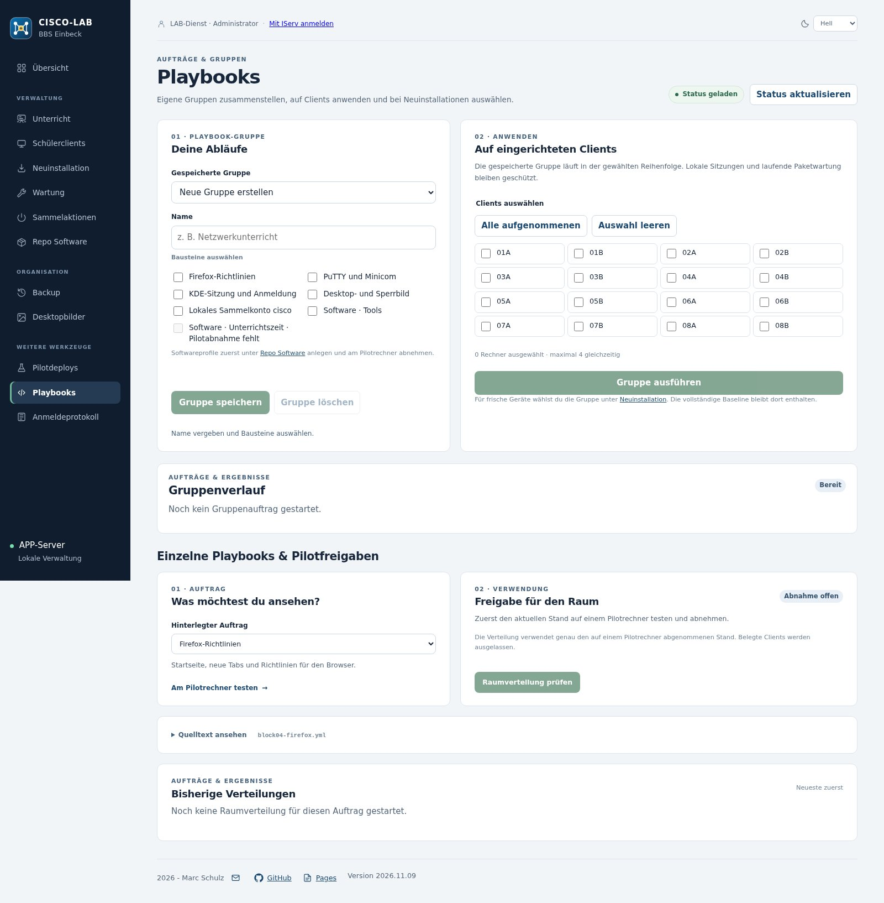

## Pilot und Raumverteilung

**Änderungen erst prüfen, dann verbreiten**

Für einzelne registrierte Aufgaben die Vorschau und den Pilotclient wählen. Der Pilotlauf liefert ein Protokoll; danach wird die praktische Sichtprüfung als Abnahme festgehalten.

Die Raumverteilung verwendet den freigegebenen Stand derselben Aufgabe. Nicht erreichbare oder fehlgeschlagene Geräte bleiben im Ergebnis erkennbar und können gezielt nachgeholt werden. Geänderte Aufgaben benötigen eine neue Freigabe.

Neuinstallationsbaseline, Softwareprofile, Playbook-Gruppen und Pilotdeploys sind unterschiedliche Werkzeuge: Die Baseline richtet einen frischen Rechner vollständig ein, Profile bündeln Pakete, Gruppen kombinieren vorhandene Bausteine und Pilotdeploys sichern einzelne Änderungen vor einer Raumverteilung ab.

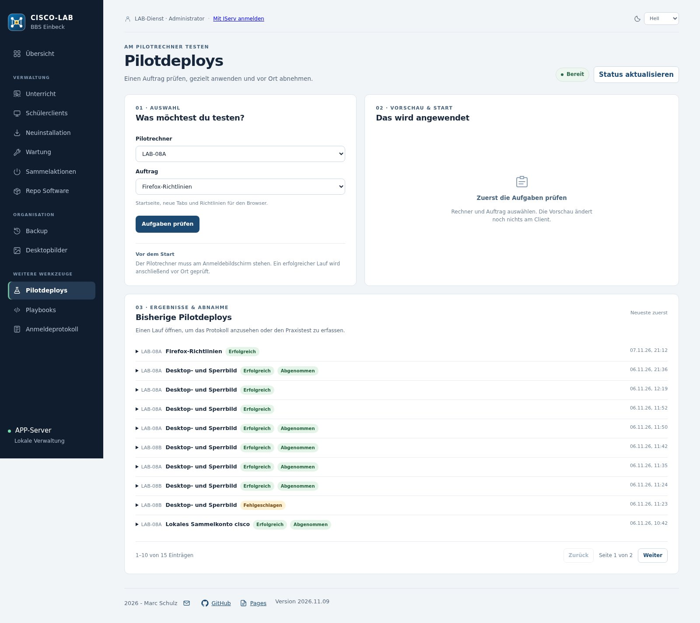

## Wartung

**Zentrale Planung mit nachvollziehbaren Ergebnissen**

APP plant die Abendwartung Montag bis Freitag im Startfenster 18–20 Uhr Europe/Berlin. Auf den Schülerclients gibt es dafür keinen zweiten lokalen Zeitplan. Der Controller berücksichtigt registrierte Geräte und kann ausgeschaltete Geräte per WOL anfordern.

Die Schülerwartung meldet Benutzer regulär ab, wartet auf das Sitzungsende, prüft Paketplanung und Systemzustand, installiert Updates und startet nach Erfolg neu. Zurückgebliebene RAM-Homes werden nur nach Prüfung behandelt. Bei Fehlern bleibt der Rechner zur Diagnose an.

Der Administrator kann Wartung auch außerhalb des Abendfensters für einzelne, mehrere oder alle aufgenommenen Schülerclients starten. Die Bestätigung umfasst Abmeldung, Updates und Neustart. Ein solcher manueller Schülerlauf startet keine nachfolgende Teacher-Phase.

Nach erfolgreicher automatischer Schülerphase folgt der Teacher über seinen begrenzten Empfänger. Lokale/grafische Sitzungen stellen seine Wartung zurück; reine SSH-Sitzungen blockieren sie nicht. Ein für die Wartung eigens gewecktes Gerät wird nach erfolgreichem Abschluss wieder ausgeschaltet; ein zuvor bereits eingeschaltetes bleibt an.

Verlauf, Detailergebnisse und Protokolle unterscheiden Erfolg, Fehler und Zurückstellung. Paketnamen der Updateplanung und der gemeinsame Clientbericht helfen bei der Kontrolle. Ein abgeschlossenes Schülerergebnis ist keine Zusage, dass auch der Teacher gewartet wurde.

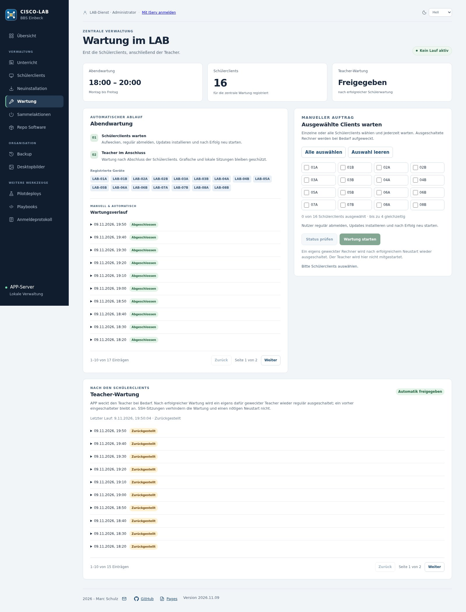

## Desktopbilder

**Desktop und Anmeldebild zentral gestalten**

Neue Bilder hochladen, in der Bibliothek ansehen und getrennt als KDE-Desktopbild oder SDDM-Anmeldebild auswählen. Die Oberfläche zeigt Vorschaubilder und die aktive Auswahl.

Den Bildstand auf einem Pilotclient prüfen und anschließend denselben freigegebenen Stand auf die vorgesehenen Rechner verteilen. Der Verteilungsverlauf zeigt je Gerät das Ergebnis. Das Ändern der Bildauswahl allein ist noch keine abgeschlossene Raumverteilung.

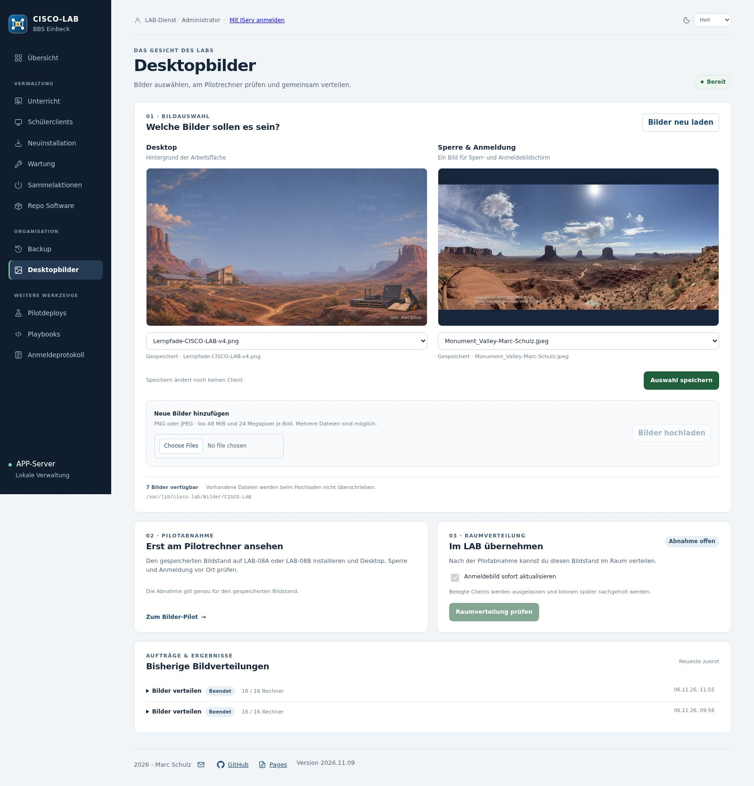

## Sicherung und Wiederherstellung

**APP, Mac und ZIP unabhängig wählen**

APP-Kopie, externe Mac-Kopie und ZIP-Download können unabhängig ausgewählt werden. Die Browserauswahl bleibt erhalten; bei einem neuen Browser ist zunächst nur APP ausgewählt. Für APP und Mac erscheinen die Ablagepfade und der jeweils letzte Sicherungsstand.

Archive bleiben verschlüsselt. Der ZIP-Download bündelt das verschlüsselte Archiv, die Prüfsumme und Wiederanlaufhinweise. Der Wiederherstellungsschlüssel gehört getrennt vom Server und den Archiven verwahrt; er wird nicht veröffentlicht.

„Alte Sicherungen bereinigen“ zeigt zunächst eine konkrete Vorschau. Die neueste APP-Kopie, die neueste Mac-Kopie und die letzte bestätigte Wiederherstellung werden geschützt. Die Bereinigung betrifft ausschließlich zugeordnete LAB-Archive.

Für einen Ersatzserver werden Sicherung, externer Schlüssel, Administratorzugang sowie Netzwerk-/DNS-/HTTPS-Einrichtung benötigt. LAB-Code, private Konfiguration, Dienstschlüssel, Bildbibliothek, Zustände und eigene LAB-Systemdateien sind Teil des Wiederanlaufs. Venv und Collections werden aus den gebundenen Abhängigkeiten neu erstellt.

Die Sicherung ist kein vollständiges Serverimage. Andere APP-Projekte, gemeinsame Webserver-/Firewallkonfiguration und HTTPS-Schlüssel sind nicht automatisch enthalten. Der öffentliche Git-Link allein enthält keine privaten Betriebsdaten. Die detaillierte Wiederanlaufanleitung liegt im Projekt und im Sicherungspaket.

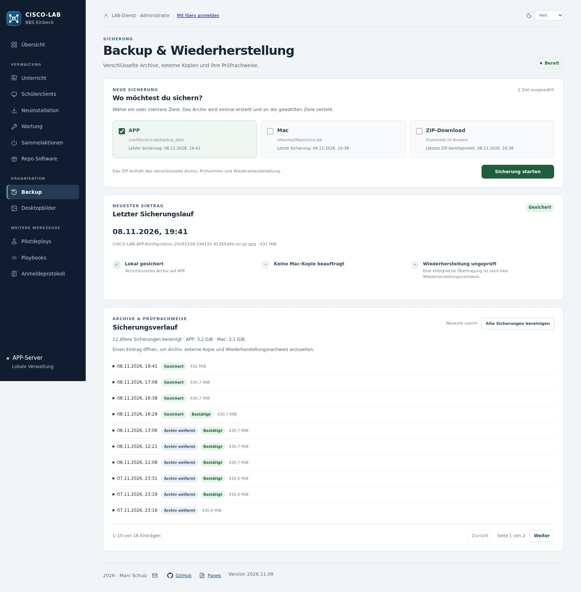

## Architektur und Einrichtung

Der öffentliche Export enthält Beispieladressen und Beispieldomänen. Vor einer eigenen Installation müssen diese Werte konsistent an die Zielumgebung angepasst werden. Die produktive Infrastrukturzuordnung bleibt privat.

Die Quellen sind auf Debian 13, KDE Plasma und die konkrete IServ-/LAB-Umgebung abgestimmt. Das ist eine nachvollziehbare Referenzimplementierung, kein universeller Ein-Klick-Installer. Inventar, OIDC-Client, Rollenzuordnung, Hardwaremanifeste und private Pakete müssen zur Zielumgebung passen. Cisco Packet Tracer, private Schlüssel und Schulzugangsdaten sind nicht Bestandteil des öffentlichen Repositorys.

Die APP-Weboberfläche lauscht lokal hinter HTTPS unter `/cisco-lab`. Ein eigenes Dienstkonto führt nur LAB-Aufträge aus. Rootgeschützter Code liegt unter `/opt/cisco-lab`; private Zustände und Dienstschlüssel unter `/var/lib/cisco-lab`. Ansible und die festgelegten Empfänger bedienen nur die vorgesehenen LAB-Ziele.

OIDC-Client, Callback-URL, stabile Administratorkennung und Kollegiumsgruppe müssen zur eigenen Schule passen. Die Beispielkonfiguration ist keine produktive Zugangskonfiguration. Für namentlich abgewiesene Konten muss IServ die verifizierte Identität an die APP übermitteln; die APP entscheidet anschließend über den Gruppenzugang.

Gemeinsame Auftragssperren verhindern konkurrierende Verwaltungsaktionen. Sichtbare Seiten aktualisieren gemeinsame Caches, statt für jeden Browser vollständige Clientinventuren zu starten. Verläufe sind mit zehn abgeschlossenen Einträgen pro Seite paginiert; aktive Aufträge bleiben zusätzlich sichtbar.

Installationsvorlagen: `deployment/apps/`; Teacher-Empfänger: `deployment/teacher/`; Wiederanlauf: [RESTORE.txt](../deployment/apps/RESTORE.txt). Für eine neue Umgebung zuerst Inventar, Pfade, Zielprüfungen und private Artefakte anpassen und einen Pilotclient prüfen.

## Clientarbeitsplatz

Die Schulnetzkarte behält die Standardroute und den IServ-Zugang. Der Labornetz-Dialog verändert nur den zugeordneten USB-Adapter. Schüler können dort manuelle IPv4-/IPv6-Adressen und gezielte Routen setzen; Schulnetz und Default-Routen bleiben geschützt. Wireshark nutzt den Laboradapter, PuTTY und Minicom den koordinierten seriellen Konsolenzugang. Unterrichtszeit ergänzt die KDE-Arbeitsfläche.

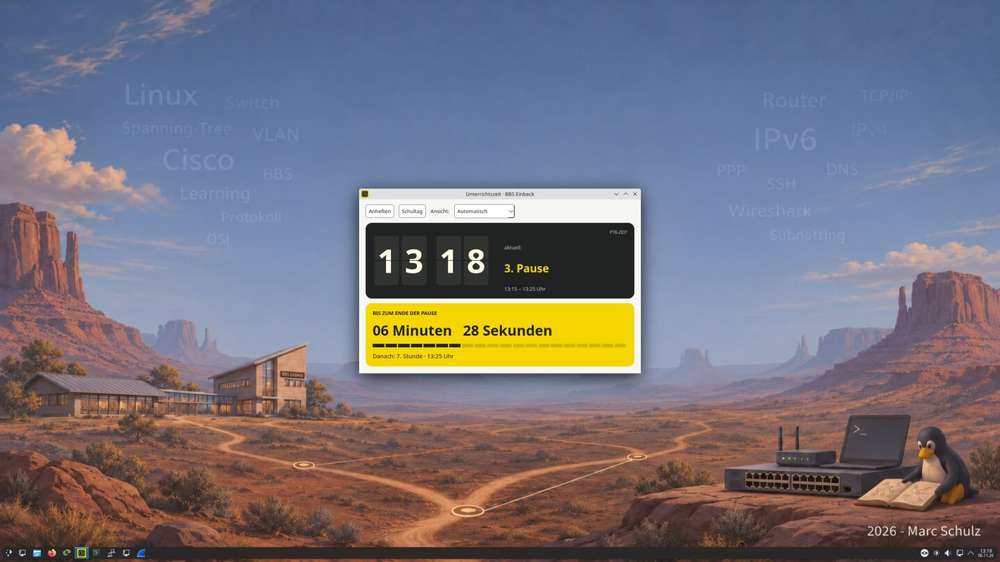

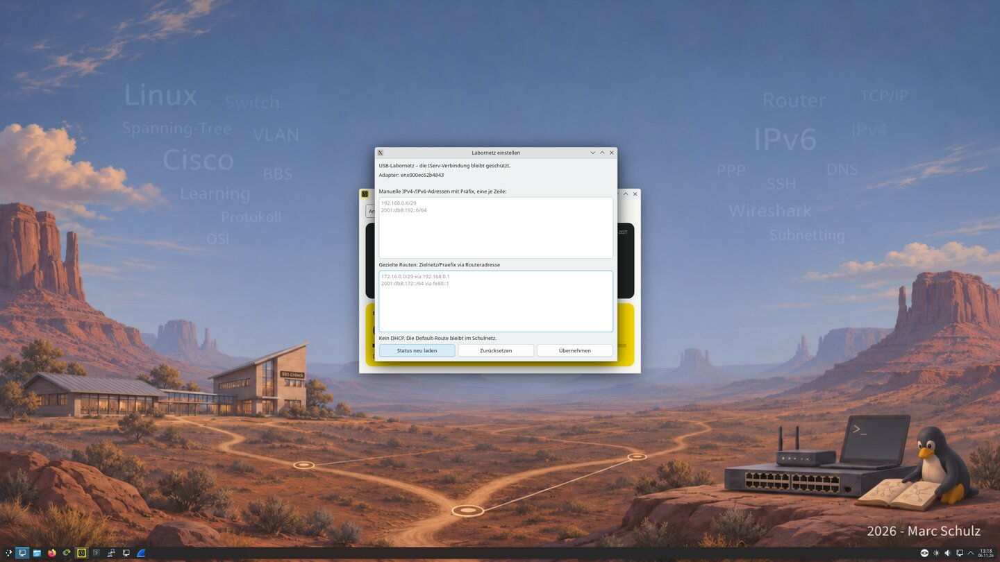

Packet Tracer ist proprietäre Zusatzsoftware und muss separat bereitgestellt werden. Lizenzzustimmung und Cisco-/NetAcad-Anmeldung richten sich nach der verwendeten Version. Eine Desktopvorbelegung ersetzt keine persönliche Cisco-Anmeldung; für die verwendete Version wird kein Offline-Gastmodus zugesichert.

## Echte APP-Aufnahmen

Die Screenshots zeigen die laufende deutsche Oberfläche in einer kontrollierten Administrationsansicht. Namen grafisch angemeldeter Personen werden für die Veröffentlichung ausgeblendet. Die englische Dokumentation beschreibt dieselben Funktionen; die Anwendung selbst ist deutschsprachig.

Die sichtbaren Zeitpunkte und Gerätezustände sind Momentaufnahmen. Sie garantieren keine spätere Erreichbarkeit. Die Lehrkräfteansicht enthält keine administrativen Schreibfunktionen außerhalb der freigegebenen Sammelaktionen.

[README](../README.md) · [Pages](https://mail896.github.io/cisco-lab-ansible/)
