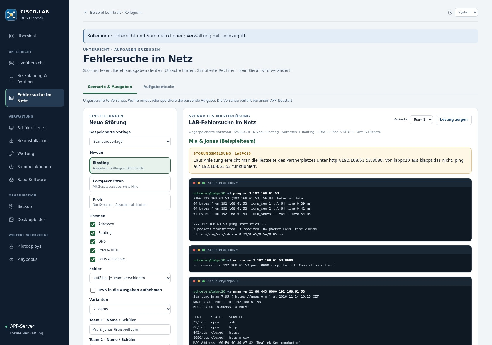
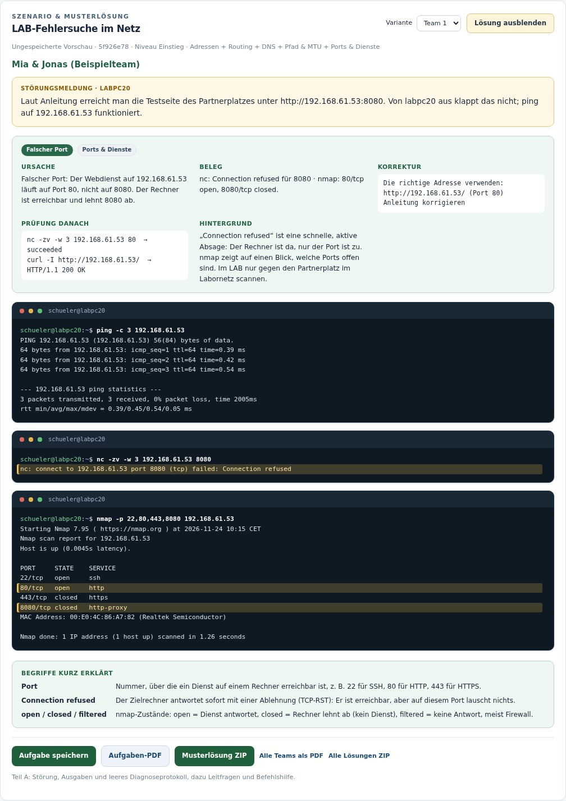
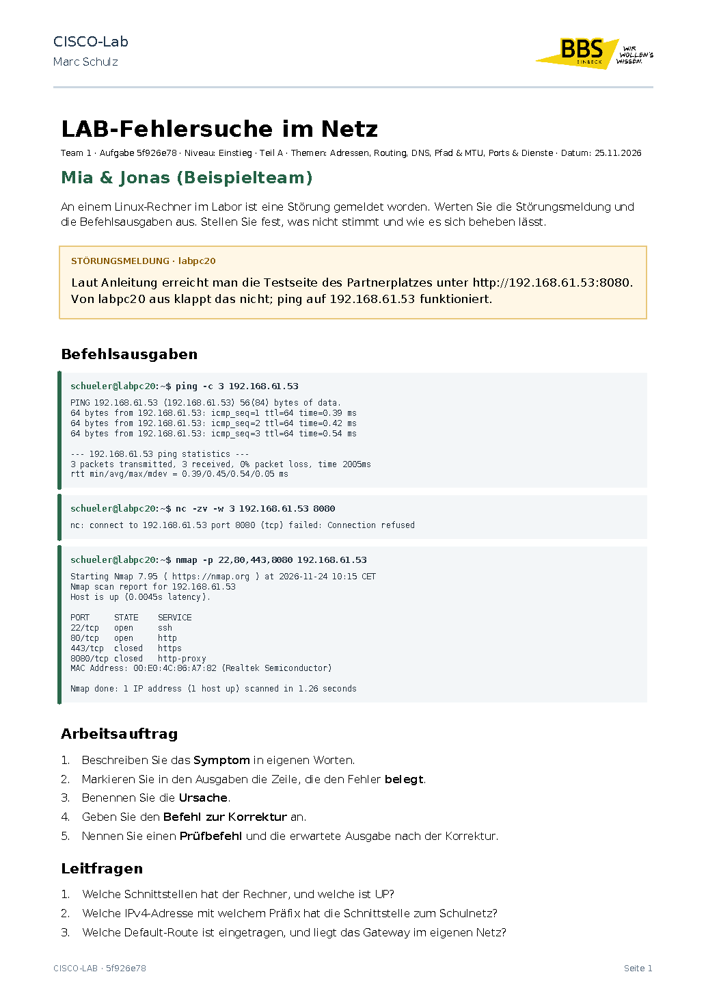

# CISCO-LAB · Network troubleshooting

[Deutsch](linux-diagnose.md)

**2026.11.25** · Practise network diagnostics and troubleshooting on the Linux command line

Teaching → Fehlersuche im Netz (network troubleshooting; called “Linux-Diagnose” until 2026.11.24) creates exercises on Linux network commands. Faults and command outputs are simulated; generating and exporting never changes a device. Rights, collection, templates and exports work as in [Netzplanung & Routing](aufgabengenerator.en.md). Students can generate exercises with model solutions through their own access but cannot save anything. Worksheets are in German.

## Parts

| Part | Content | Devices |
|---|---|---|
| **A · Diagnose a fault from outputs** | Trouble ticket and realistic outputs of a simulated Debian host; determine cause, evidence, fix and verification | none |
| **B · Explore the live LAB client** | Read-only commands on the student's own lab PC for the selected topics, with a result column | read-only |
| **Wireshark capture** (with B) | Partner seats A and B connect their USB lab adapters, set given addresses in the lab network dialog and capture ARP, ICMP and the TCP handshake | lab network |
| **C · Packet Tracer team swap** | Build plan with addresses and routes, a hidden fault card per team, a checklist for the received file | Packet Tracer |

## Topics and faults in part A

| Topic | Faults |
|---|---|
| Addressing | wrong netmask, address in the wrong network, duplicate IP address, interface down, missing global IPv6 address (IPv6 only) |
| Routing | missing default route, wrong gateway, route via the wrong interface |
| DNS | wrong DNS server, typo in the search domain, NXDOMAIN, stale /etc/hosts entry |
| Path & MTU | path ends behind the firewall, routing loop, PMTU black hole, wrong interface MTU |
| Ports & services | service bound to 127.0.0.1, service not running, wrong port, port filtered by a firewall |

Each fault is applied to a self-consistent host model and every output is rendered from that state. The lines proving the fault are known and highlighted in the solution. With several teams each team first gets a different fault. All addresses and names are fictitious (private and documentation ranges, `schule.example`, `example.org`).

## Levels

- **Einstieg (beginner):** all outputs, guiding questions and a command reference for the selected topics; full commands in part B.
- **Fortgeschritten (intermediate):** one extra unrelated output, no help; part B names the tool only.
- **Profi (expert):** trouble ticket and first output only. Further outputs are cut-out cards in the model solution, handed out when a team names and justifies a suitable command. Part B without commands.

## Workflow

1. Choose level, topics, fault (random or fixed), IPv6, team count, team names and parts.
2. **Create preview.** It shows ticket, terminals, part B and part C. **Show solution** highlights the evidence lines and reveals solutions, expected values, capture expectations, the fault-card resolution and term explanations.
3. Edit the texts in the text tab; placeholders `{{team}}`, `{{rechner}}`, `{{niveau}}`.
4. **Save** stores the state in the shared collection. Later program or template changes never alter saved states.
5. Download the **worksheet PDF** and the **solution ZIP** per team or for all teams.

## Model solution

The solution states cause, evidence, fix commands, verification and background. **Begriffe kurz erklärt** explains the technical terms used (e.g. search domain, NXDOMAIN, DF bit, loopback, TCP handshake). Part B includes the method and expected values from the APP inventory with its date and the school addresses of all seats; they come from configuration, not from querying clients. The ZIP also contains a text solution, the scenario as JSON and the individual outputs per team.

## Limits

- Part B and the capture run on real clients but only change the lab network through the existing dialog. `nmap` is used only in the lab network against the partner seat.
- `dig` and `nslookup` need `bind9-dnsutils`, which is part of the client baseline.
- Wireshark captures on the USB lab adapter only.
