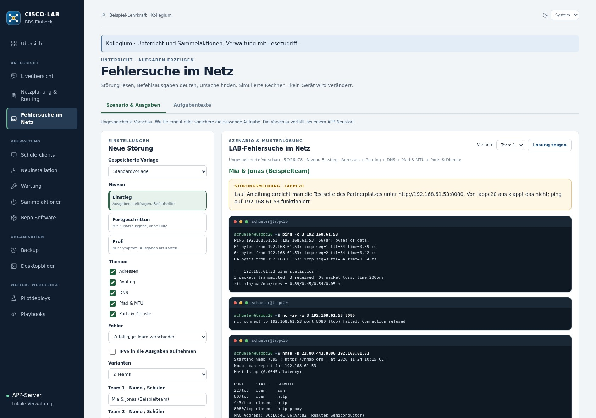
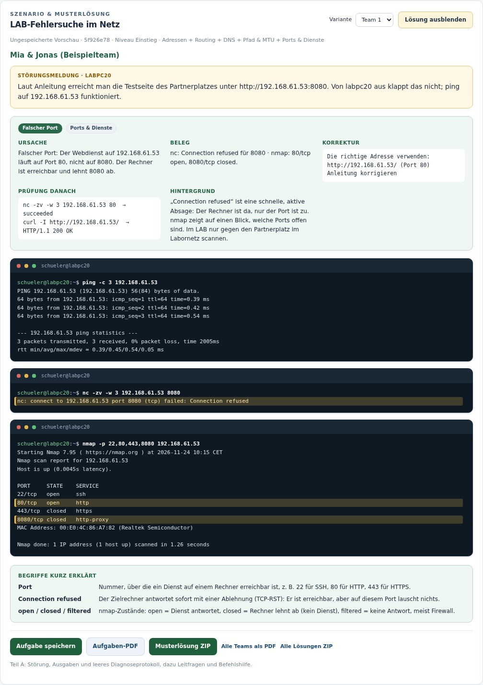
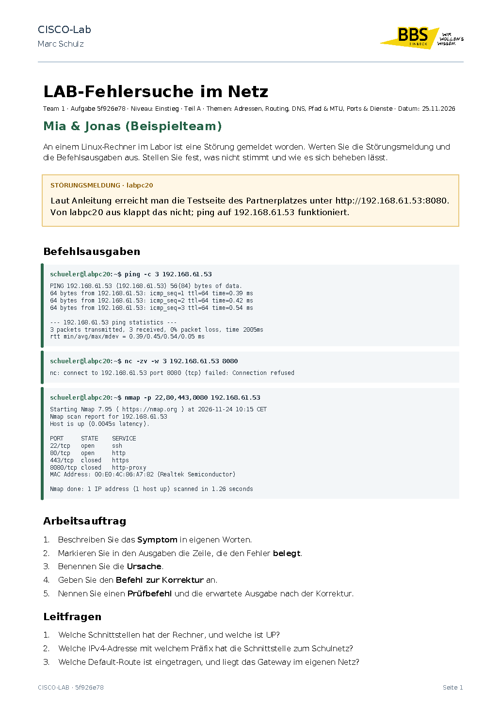

# CISCO-LAB · Fehlersuche im Netz

[English](linux-diagnose.en.md)

**2026.11.25** · Netzwerkdiagnose und Troubleshooting auf der Linux-Kommandozeile üben

Unter Unterricht → Fehlersuche im Netz (bis 2026.11.24 „Linux-Diagnose“) entstehen Übungen zu Netzwerkbefehlen unter Linux. Störungen und Befehlsausgaben werden simuliert; die Erzeugung und die Exporte verändern keine Geräte. Rechte, Sammlung, Vorlagen und Exporte funktionieren wie bei [Netzplanung & Routing](aufgabengenerator.md). Schülerinnen und Schüler können über ihren eigenen Zugang Übungen mit Musterlösung erzeugen, aber nichts speichern.

## Aufgabenteile

| Teil | Inhalt | Geräte |
|---|---|---|
| **A · Störung aus Ausgaben diagnostizieren** | Störungsmeldung und realistische Ausgaben eines simulierten Debian-Rechners; Ursache, Beleg, Korrektur und Prüfung bestimmen | keine |
| **B · Live am LAB-Client erkunden** | Lesende Befehle am eigenen Laborrechner zu den gewählten Themen; Ergebnisspalte zum Ausfüllen | nur lesend |
| **Wireshark-Mitschnitt** (zu B) | Partnerplätze A und B verbinden ihre USB-Laboradapter, stellen vorgegebene Adressen im Labornetz-Dialog ein und schneiden ARP, ICMP und den TCP-Verbindungsaufbau mit | Labornetz |
| **C · Packet-Tracer-Teamtausch** | Bauplan mit Adressen und Routen, verdeckte Fehlerkarte je Team, Prüfauftrag für die erhaltene Datei | Packet Tracer |

## Themen und Fehler in Teil A

| Thema | Fehler |
|---|---|
| Adressen | falsche Netzmaske, Adresse im falschen Netz, doppelte IP-Adresse, Schnittstelle abgeschaltet, fehlende globale IPv6-Adresse (nur mit IPv6) |
| Routing | Default-Route fehlt, falsches Gateway, Route über die falsche Schnittstelle |
| DNS | falscher DNS-Server, Tippfehler in der Suchdomain, NXDOMAIN, veralteter Eintrag in /etc/hosts |
| Pfad & MTU | Weg endet hinter der Firewall, Routing-Schleife, PMTU-Blackhole, falsche MTU an der Schnittstelle |
| Ports & Dienste | Dienst nur auf 127.0.0.1, Dienst läuft nicht, falscher Port, Port von Firewall gefiltert |

Jede Störung wird auf ein in sich stimmiges Rechnermodell angewendet; alle Ausgaben werden aus diesem Zustand berechnet. Die Zeilen, die den Fehler belegen, sind bekannt und werden in der Lösung markiert. Bei mehreren Teams erhält jedes Team zuerst einen anderen Fehler. Alle Adressen und Namen sind erfunden (private Netze, Dokumentationsnetze, `schule.example`, `example.org`).

## Niveaus

- **Einstieg:** alle Ausgaben, Leitfragen und Befehlshilfe passend zu den Themen; in Teil B der vollständige Befehl.
- **Fortgeschritten:** zusätzlich eine unauffällige Ausgabe ohne Fehlerbezug, keine Hilfe; in Teil B nur das Werkzeug.
- **Profi:** nur Störungsmeldung und erste Ausgabe. Die übrigen Ausgaben liegen als Ausgabekarten zum Ausschneiden in der Musterlösung und werden auf begründete Nachfrage ausgegeben. In Teil B ohne Befehlsangabe.

## Workflow

1. Niveau, Themen, Fehler (zufällig oder fest), IPv6, Teamanzahl, Teamnamen und Aufgabenteile wählen.
2. **Vorschau erzeugen.** Die Vorschau zeigt Störungsmeldung, Terminals, Teil B und Teil C. **Lösung zeigen** markiert die Belegzeilen in den Terminals und blendet Lösung, Sollwerte, Erwartungen zum Mitschnitt, die Auflösung der Fehlerkarten und die Begriffserklärungen ein.
3. Texte im Tab Aufgabentexte anpassen; Platzhalter `{{team}}`, `{{rechner}}`, `{{niveau}}`.
4. **Aufgabe speichern** legt den Stand in der gemeinsamen Sammlung ab. Gespeicherte Stände ändern sich durch spätere Programm- oder Vorlagenänderungen nicht.
5. **Aufgaben-PDF** und **Musterlösung ZIP** je Team oder für alle Teams herunterladen.

## Musterlösung

Die Musterlösung enthält Ursache, Beleg, Korrekturbefehle, Prüfung und Hintergrund. **Begriffe kurz erklärt** erläutert die verwendeten Fachbegriffe (z. B. Suchdomain, NXDOMAIN, DF-Bit, Loopback, TCP-Handshake). Teil B enthält Lösungsweg und erwartete Werte laut APP-Inventar mit Stand-Datum sowie die Schuladressen aller Plätze; die Werte stammen aus der Konfiguration, nicht aus einer Abfrage der Clients. Das ZIP enthält zusätzlich je Team eine Textlösung, das Szenario als JSON und die einzelnen Ausgaben.

## Teil C im Unterricht

Jedes Team baut das Netz nach Plan, prüft alle Verbindungen und speichert eine funktionierende Kopie. Danach baut es den Fehler von seiner Fehlerkarte ein und gibt nur die Fehlerdatei an das nächste Team weiter (Team 1 an Team 2, das letzte an Team 1). Das empfangende Team dokumentiert Symptom, Beleg, Ursache und Korrektur. Die Fehlerkarte steht am Ende jeder Teamseite zum Abtrennen. Eine fertige .pkt-Datei erzeugt der Generator nicht.

## Grenzen

- Teil B und der Mitschnitt laufen auf echten Clients, verändern aber nur das Labornetz über den vorhandenen Dialog. `nmap` wird nur im Labornetz gegen den Partnerplatz eingesetzt.
- `dig` und `nslookup` benötigen das Paket `bind9-dnsutils`; es ist Teil der Client-Baseline.
- Wireshark schneidet nur am USB-Laboradapter mit.
