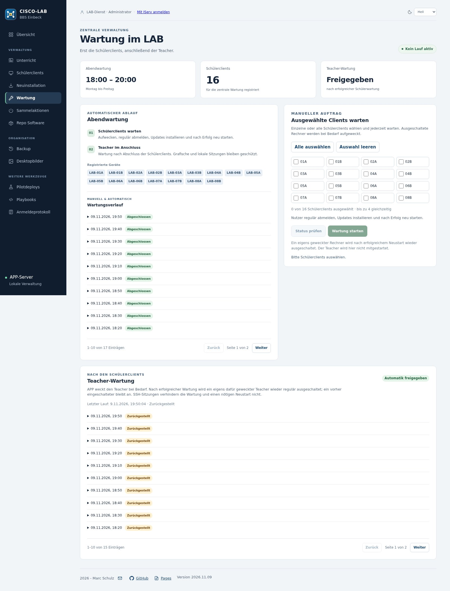

# Package maintenance

**English** · [Deutsch](wartung-vorschau.md)

APP schedules evening maintenance Monday to Friday within the 18:00–20:00 Europe/Berlin start window. Student clients do not have a competing local schedule. The controller considers enrolled devices and can request powered-off devices through WOL.

Student maintenance signs users out normally, waits for session completion, checks the package plan and system state, installs updates and reboots after success. Leftover RAM homes are handled only after checks. Failures leave the device running for diagnosis.

The administrator can also start maintenance outside the evening window for one, several or all enrolled student clients. Confirmation covers sign-out, updates and reboot. A manual student run does not trigger a subsequent teacher phase.

After a successful automatic student phase, the teacher follows through its restricted receiver. Local/graphical sessions defer teacher maintenance; SSH-only sessions do not block it. A device woken specifically for maintenance is shut down after successful completion; a device that was already on remains on.

History, detailed results and logs distinguish success, failure and deferral. Planned update package names and the shared client report support verification. A completed student result does not imply that the teacher was maintained as well.

The preview checks sessions, proposed package removals, bootable kernels and the version-specific Winbind fix. APT/dpkg locks must not be bypassed. Package transactions already in progress are allowed to finish.

[User guide and workflows](dashboard.en.md#maintenance)
