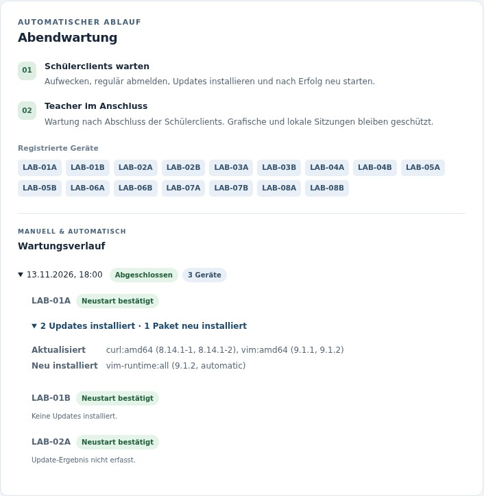
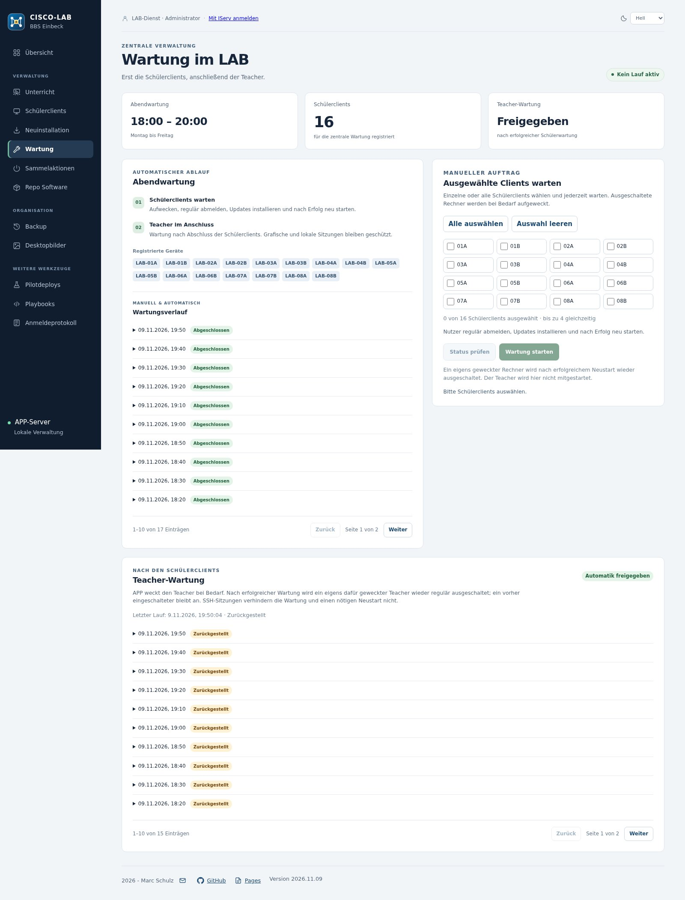

# Paketwartung

**Deutsch** · [English](wartung-vorschau.en.md)

APP plant die Abendwartung Montag bis Freitag im Startfenster 18–20 Uhr Europe/Berlin. Auf den Schülerclients gibt es dafür keinen zweiten lokalen Zeitplan. Der Controller berücksichtigt registrierte Geräte und kann ausgeschaltete Geräte per WOL anfordern.

Die Schülerwartung meldet Benutzer regulär ab, wartet auf das Sitzungsende, prüft Paketplanung und Systemzustand, installiert Updates und startet nach Erfolg neu. Zurückgebliebene RAM-Homes werden nur nach Prüfung behandelt. Bei Fehlern bleibt der Rechner zur Diagnose an.

Der Administrator kann Wartung auch außerhalb des Abendfensters für einzelne, mehrere oder alle aufgenommenen Schülerclients starten. Die Bestätigung umfasst Abmeldung, Updates und Neustart. Ein solcher manueller Schülerlauf startet keine nachfolgende Teacher-Phase.

Nach erfolgreicher automatischer Schülerphase folgt der Teacher über seinen begrenzten Empfänger. Lokale/grafische Sitzungen stellen seine Wartung zurück; reine SSH-Sitzungen blockieren sie nicht. Ein für die Wartung eigens gewecktes Gerät wird nach erfolgreichem Abschluss wieder ausgeschaltet; ein zuvor bereits eingeschaltetes bleibt an.

Verlauf, Detailergebnisse und Protokolle unterscheiden Erfolg, Fehler und Zurückstellung. Paketnamen der Updateplanung und der gemeinsame Clientbericht helfen bei der Kontrolle. Ein abgeschlossenes Schülerergebnis ist keine Zusage, dass auch der Teacher gewartet wurde.

Im Wartungsverlauf steht je Schülerclient, wie viele Updates tatsächlich installiert wurden. Aufklappbare Paketdetails nennen aktualisierte, neu installierte und entfernte Pakete mit Versionsangaben. Der Nachweis wird nach bestätigter Wartung einmalig aus abgeschlossenen LAB-Transaktionen im APT-Verlauf gelesen und im APP-Lauf gespeichert. Beim Öffnen oder Blättern erfolgen keine zusätzlichen Clientabfragen. Ältere Läufe und nicht eindeutig lesbare Verläufe zeigen „Update-Ergebnis nicht erfasst“; fehlende Daten werden nicht als null Updates ausgegeben. Die Schülerclient-Seite zeigt dagegen noch verfügbare Updates.

Kontrollierte APP-Ansicht mit beispielhaften Paketnachweisen; keine echte Installationsstatistik.

Die Vorschau prüft unter anderem Sitzungen, vorgeschlagene Paketentfernungen, bootfähige Kernel und den versionsgebundenen Winbind-Fix. APT-/dpkg-Sperren dürfen nicht umgangen werden. Begonnene Pakettransaktionen dürfen fertig werden.

[Bedienung und Workflows](dashboard.md#maintenance)
